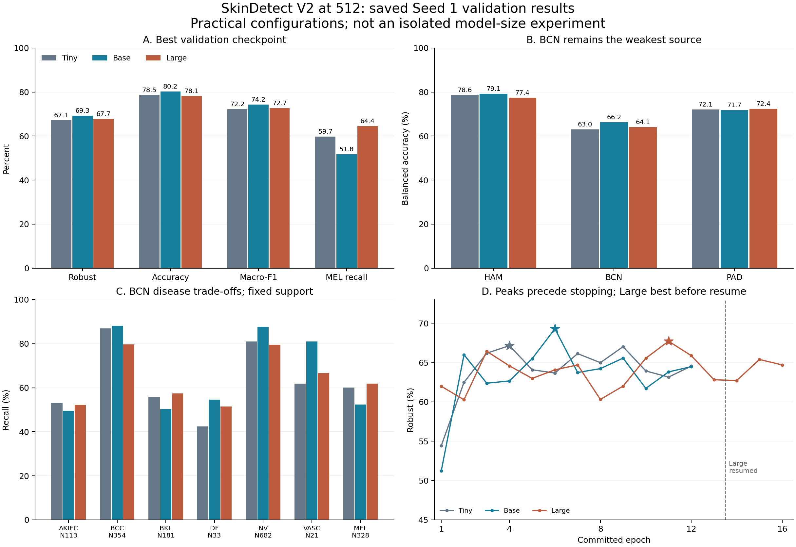

# 512模型大小正式判讀與唯一下一批提案｜2026-10-26 v1

**Base是本輪最值得確認的配置，還不是可直接採納的模型。** 同Seed1，Base相對Tiny Robust +2.1424pp、Accuracy +1.6893pp、Macro-F1 +2.0581pp，BCN DF／VASC／NV有收益；但合併MEL Recall −7.9051pp，BCN BKL與PAD BKL亦下降。Large相對Base Robust −1.5765pp，卻保留較高MEL Recall，不能只按大小或Robust單分數宣布全方位勝負。

**唯一推薦組合：先Base Seed2、Seed3（保留2×32），再Large Seed1的2×32配置對照；3個新run、最多90完整Epoch。** 前兩個確認目前最佳實用配置的穩定性與MEL代價，第三個消除Large micro1沒有跨圖MixUp這個已知配置差異的一部分。只延伸有結果／有機制的兩個問題，不併入新LR、alpha、Patience、解析度或Huge搜尋。具體完整可貼[B草案](B_NEXT_BATCH_DRAFT.md)；**本次沒有執行或授權新訓練。**

## 1. 本輪狀態、輸入與方法

依最新版AGENTS及兩共用入口，D直接承接B→總控交付。新目錄只存本D分析，不修改共用索引，後續由總控追加。工作目錄D:/SkinDetect_base，2026-10-26臺北日期。

- 新主要輸入：資料治理與泛化修復/results/v2_scale512_seed1_20261025_v1的FINAL_RESULTS、B_HANDOFF、Base／Large result、run_inputs及metrics_*.jsonl；對應configs及既有preflight。
- Tiny只引用原v2_resolution_20261021_v1/runs/v2in_res512/regularized_seed1，Run1e32c15f7f13453983d2552608333e39，不用Tiny三Seed均值充作Seed1對照。
- Base Run efc7718472e14007be0686800f5183c3，12輪／最佳6；Large Run7c6b140d4ed442389852be8707d8e2c6，16輪／最佳11。兩者completed／early_stopping，合28完整輪；Huge只估算略過，無訓練品質結果，不能稱淘汰或實測OOM。
- 只在已保存的混淆矩陣／逐輪日誌計算本次新比較；以FINAL values交叉核對，合併Accuracy／Macro-F1不是三來源Macro-F1再取平均。BA只平均來源支持類；PAD DF／VASC為N/A。
- 小型輸入SHA／欄位／242項算術檢查見SOURCE_EVIDENCE.json、NUMERIC_QA.json。相同Train／Val IDs、資料manifest SHA、類別順序、來源定義、effective transforms均一致；沒有重新載權重／開圖／推論或重做完整稽核。
- 已完成root_cause、resolution_decision及342張匹配診斷直接引用，沒有重跑它們或重建全量逐張預測。新派生表保留來源路徑，未改上游結果。

## 2. 同Seed整體與來源結果

|模型／Seed1|微批×累積|最佳／完成輪|Robust%|Accuracy%|Macro-F1%|合併MEL Recall%|
|---|---|---|---|---|---|---|
|Tiny|8×8|4/12|67.1483|78.5378|72.1627|59.6838|
|Base|2×32|6/12|69.2906|80.2271|74.2208|51.7787|
|Large|1×64|11/16|67.7141|78.1224|72.6731|64.4269|

三者都是單Seed的最佳Validation輪；Base／Large的Seed SD未知，不能填0、報顯著或把本表寫成三Seed排名。Large−Tiny：Robust +0.5658pp、Accuracy −0.4154pp、Macro-F1 +0.5104pp、合併MEL +4.7431pp；Large並非完全沒有收益，但其較高成本尚無較高Robust回報。

|來源|N|Tiny BA%|Base BA%|Large BA%|Base−Tiny pp|Large−Base pp|
|---|---|---|---|---|---|---|
|HAM10000|1504|78.6289|79.1411|77.3710|+0.5123|-1.7701|
|BCN20000|1712|63.0332|66.2271|64.1252|+3.1939|-2.1019|
|PAD-UFES-20|395|72.1279|71.6944|72.4129|-0.4335|+0.7185|

本次三個best及40個已保存完整Epoch均是BCN最低，這一範圍內R=(HAM+PAD+4BCN)/6。下表只是數值貢獻，不是訓練根因；最低來源變更時不能直接外推同一權重。

|對比|HAM對ΔR pp|BCN對ΔR pp|PAD對ΔR pp|合計ΔR pp|
|---|---|---|---|---|
|Base−Tiny|+0.0854|+2.1292|-0.0723|+2.1424|
|Large−Tiny|-0.2096|+0.7280|+0.0475|+0.5658|
|Large−Base|-0.2950|-1.4013|+0.1198|-1.5765|

Base對Tiny的+2.1424pp，BCN貢獻+2.1292pp、HAM+0.0854pp、PAD−0.0723pp，收益集中於BCN；Large比Base的BCN BA−2.1019pp單獨貢獻−1.4013pp Robust，是主要總分差來源。

## 3. 全來源疾病TP/N與Recall：收益與犧牲一起保留

|來源|疾病|固定N|Tiny TP/N；Recall|Base TP/N；Recall|Large TP/N；Recall|Base−Tiny pp|Large−Base pp|
|---|---|---|---|---|---|---|---|
|HAM10000|AKIEC|49|37/49；75.51%|36/49；73.47%|32/49；65.31%|-2.0408|-8.1633|
|HAM10000|BCC|77|70/77；90.91%|66/77；85.71%|62/77；80.52%|-5.1948|-5.1948|
|HAM10000|BKL|165|132/165；80.00%|131/165；79.39%|132/165；80.00%|-0.6061|+0.6061|
|HAM10000|DF|18|13/18；72.22%|14/18；77.78%|14/18；77.78%|+5.5556|+0.0000|
|HAM10000|NV|1006|900/1006；89.46%|964/1006；95.83%|900/1006；89.46%|+6.3618|-6.3618|
|HAM10000|VASC|22|18/22；81.82%|20/22；90.91%|17/22；77.27%|+9.0909|-13.6364|
|HAM10000|MEL|167|101/167；60.48%|85/167；50.90%|119/167；71.26%|-9.5808|+20.3593|
|BCN20000|AKIEC|113|60/113；53.10%|56/113；49.56%|59/113；52.21%|-3.5398|+2.6549|
|BCN20000|BCC|354|308/354；87.01%|312/354；88.14%|282/354；79.66%|+1.1299|-8.4746|
|BCN20000|BKL|181|101/181；55.80%|91/181；50.28%|104/181；57.46%|-5.5249|+7.1823|
|BCN20000|DF|33|14/33；42.42%|18/33；54.55%|17/33；51.52%|+12.1212|-3.0303|
|BCN20000|NV|682|552/682；80.94%|598/682；87.68%|542/682；79.47%|+6.7449|-8.2111|
|BCN20000|VASC|21|13/21；61.90%|17/21；80.95%|14/21；66.67%|+19.0476|-14.2857|
|BCN20000|MEL|328|197/328；60.06%|172/328；52.44%|203/328；61.89%|-7.6220|+9.4512|
|PAD-UFES-20|AKIEC|135|113/135；83.70%|112/135；82.96%|124/135；91.85%|-0.7407|+8.8889|
|PAD-UFES-20|BCC|146|123/146；84.25%|127/146；86.99%|117/146；80.14%|+2.7397|-6.8493|
|PAD-UFES-20|BKL|55|39/55；70.91%|34/55；61.82%|41/55；74.55%|-9.0909|+12.7273|
|PAD-UFES-20|DF|0|N/A|N/A|N/A|N/A|N/A|
|PAD-UFES-20|NV|48|41/48；85.42%|39/48；81.25%|38/48；79.17%|-4.1667|-2.0833|
|PAD-UFES-20|VASC|0|N/A|N/A|N/A|N/A|N/A|
|PAD-UFES-20|MEL|11|4/11；36.36%|5/11；45.45%|4/11；36.36%|+9.0909|-9.0909|

固定N是各模型相同Validation病例清單的影像數，沒有把三模型合併當三倍獨立樣本；同Seed也不等同病人獨立抽樣。N21的BCN VASC一張即4.7619pp Recall，N33的DF一張3.0303pp；PAD MEL N11一張9.0909pp，細類排名易受少量影像影響。

### Base改善在哪裡，代價是什麼

1. BCN DF14→18/33（+12.1212pp）、VASC13→17/21（+19.0476pp）、NV552→598/682（+6.7449pp）。在BCN仍最低時，DF／VASC各+4張合計貢獻Robust約+2.9685pp，超過最終淨收益；其他類損失抵銷一部分。這表示收益依賴少量類別的命中，不是整體BCN疾病全面改善。
2. BCN BKL101→91/181（−5.5249pp）、MEL197→172/328（−7.6220pp），HAM MEL101→85/167（−9.5808pp）、PAD BKL39→34/55（−9.0909pp）。BCN BKL／MEL各對Robust約−0.5262／−0.7259pp，不能被NV高分掩蓋。
3. 合併NV命中1493→1601（+108），MEL302→262/506（−40），其他類總命中−7，所以全體命中淨+61／3611，Accuracy升1.6893pp；Macro-F1也升，仍不能推出MEL無犧牲。合併MEL Recall59.6838→51.7787%。
4. 原矩陣流向顯示HAM MEL→NV43→66、BCN89→111；NV→MEL則HAM60→13、BCN76→41。這支持決策輸出在NV／MEL間有取捨的觀察，但不是逐圖共同錯誤配對，也不證明單一MixUp／表示能力根因。BCN DF TP雖+4，DF→BCC卻9→10，其餘去向變化才是淨收益，不能聲稱DF→BCC已修復。

### Large未超越Base的已知證據／未定原因

Large比Base的BCN BCC312→282（−8.4746pp）、NV598→542（−8.2111pp）、VASC17→14（−14.2857pp）、DF18→17（−3.0303pp），超過BKL91→104（+7.1823pp）／MEL172→203（+9.4512pp）／AKIEC56→59的收益；HAM BA另降1.7701pp。Large的HAM MEL119/167、BCN MEL203/328均高於Base，合併MEL326/506（64.4269%），相對Base+12.6482pp。這是疾病取捨，不是Large完全未學到或所有類都差。

已確認Large1×64使原microbatch-local randperm只有自身；MixUp alpha .2雖名義相同，數學上沒有跨圖混合（仍可能有浮點舍入，不宣稱等同另一條程式逐位元結果）。Base2每個兩張完整批，randperm有1/2機會自身、1/2交換；Tiny8任一位置非自身的期望比例7/8，Base2為1/2。這只描述索引排列機會，仍有同類／抽樣重複與末批，並非實際不同疾病混合率。有效Batch64無法使配對池等價。

因此不能單從本輪斷言「模型大反而差」「Large缺MixUp就是唯一原因」或「應改LR」。實際大小、micro、累積步數／末組、隨機序列與預訓練表示共同變動；本機配置選擇是實用初篩。初始化類型均為釘選FCMAE ImageNet1K、分類head新建／空optimizer，既有預檢有完整累積、AdamW狀態分配／backbone更新；本次無新證據要求重測這些已通過檢查。

## 4. 曲線、匹配診斷與恢復限制

|模型|最佳→停止輪|Monitor BA%|Robust%|BCN BA%|Monitor loss|
|---|---|---|---|---|---|
|Tiny|4→12|92.6005→98.3506|67.1483→64.5490|63.0332→59.1111|0.6302→0.4906|
|Base|6→12|93.7592→97.9443|69.2906→64.4792|66.2271→59.2923|0.5823→0.4944|
|Large|11→16|98.5558→99.2536|67.7141→64.7015|64.1252→60.0093|0.4871→0.4657|

Base第6輪69.2906%，下一個最高完整輪只有65.9945%，兩者差3.2961pp；其最佳後monitor提高而Robust掉4.8114pp。Large最佳後monitor仍提高，最終Robust較最佳掉3.0126pp。這支持繼續擬合未自動轉成Validation收益；Base高峰是否可重現，正是Seed2／3要回答的問題。這些Epoch不是獨立重複實驗，不能用峰值差作標準差或事後換輪／改早停。

Tiny原曲線欄位只作本次同Seed新圖的對照引用，沒有重跑root_cause／原224或320早停驗收程式，亦不重新判定既有結案。

原monitor是混合1500張、eval前處理，不是各來源匹配Train分數；訓練loss另含增強／MixUp／train模式，不能把Train loss與Validation loss當完全同條件直接比較。既有早停邏輯有Min12：Base第11輪bad_epochs5尚未到Min12，第12輪bad6正常停止；Large best11之後連5輪未改善在16停。歷史Patience8未執行，沒有新證據將它列為必選。

直接引用B已完成matched_source_trainval_512_20261025_retry1_v1：342張、兩模型684正式前向，沒有重做。原Tiny512 BCN AKIEC Train10/16、Val7/16，MEL8/16、Val7/16，不符合「都已學好只是Val差」；DF兩模型Train9/10、Val6/10或5/10，才有泛化落差線索。HAM MEL／DF也有gap，且BCN−HAM gap≥10pp未在兩權重主要弱類一致重現。因此共同資料／類別與部分擬合／泛化問題仍存在，**不能把舊Tiny匹配結果直接當Base／Large的Train細類證據**。兩權重最佳輪4/8不同、小便利樣本，不能推出純alpha或模型容量根因。root_cause的已排除／未定結論及16張影像限制保持，不重啟影像／標錯搜尋。

### Large中斷與Resume：成功完成，但不宣稱連續等價

- 首次CUDA unknown error在進入14輪後，13輪已提交；未知是否驅動／OOM／其他原因，使用者重裝驅動只是時間背景。
- Resume1第14輪存檔失敗是已確認B包裝函式被納入scheduler state導致不可序列化，與最初CUDA錯誤分開。該輪未提交，不算第14完整輪。
- Resume2新版本移除實例方法覆寫、CPU微型序列化／雙代存檔已通過；RESTORED_STATE及WORKER_RECEIPT確認同Run由13接14，model、380組AdamW state、scheduler／scaler／RNG／sampler／loader、history／best11／bad2及LR6.07916e-5恢復。14–16提交成功、bad3/4/5，正常早停。
- CHECKPOINT_LOADED.json殘留status=failed是worker初始預設、在完整restore前寫出的中間收據；源碼resume_worker.py:55/86/110–117及後續RESTORED_STATE= resumed、WORKER_RECEIPT= completed／最終result=completed已說明順序。它不是第二個當前失敗，也不被刪掉或改寫。本D只讀這些既有收據，未獨立重載Checkpoint驗收。
- **最佳輪11在所有中斷之前，最終best與該輪指標一致。** 所以Large低於Base不能直接歸因恢復把已存在best弄壞；但恢復後persistent-worker內部RNG不保證逐位元重播，driver616.92與重裝前版本未知，14–16的軌跡／速度不是未中斷反事實。不能證明不間斷時一定仍輸或一定能贏。

## 5. 真實耗時、顯存與包含關係

|模型|完整輪總時分|非首輪中位分/輪|正式attempt總時分|配置峰值GiB|保留峰值GiB|
|---|---|---|---|---|---|
|Tiny|76.881|6.287|未在scale計帳；不補量測|4.8465|4.9609|
|Base|147.718|12.181|147.920|3.7698|3.8320|
|Large|341.900|20.957|391.405|5.0720|5.2988|

「完整輪總時」來自已提交metrics epoch_seconds；「正式attempt」包含初始化／失敗清理及未提交輪，兩欄不可相加。Tiny歷史result.elapsed_seconds4613.046秒只含trainer計時邊界，並未冒充本輪controller attempt總時。

- Base完整輪8863.093秒，attempt8875.201秒；Large完整16輪20513.980秒，原失敗attempt17812.212＋Resume1失敗1553.620＋Resume2成功4118.443＝23484.275秒（6.523小時）。Large result.elapsed_seconds20514.383接續的是已提交輪trainer累積，沒有將兩次中斷消耗當成零。
- Base＋Large正式attempt總32359.476秒（8.989小時）。其中failed_attempt_seconds19365.831包含原Large成功13輪，**不是全部浪費**；successful resume_attempt_seconds4118.443已在總額內。總attempt減完整輪2970.295秒是Large未提交工作／初始化／退出等差額，不可全部歸為某一故障或CPU等待。無人為排程等待的可比較完整計帳，不從UTC牆鐘差硬算GPU時間。
- Monitor／Validation／存檔、資料等待／批次處理均是輪內分項；沒有再次加總。Tiny歷史未獨立分開Monitor／Validation計時，保留未提供。既有預檢另帳，沒有重新測成本。
- 峰值為torch CUDA配置／保留bytes轉GiB，非桌面總占用或純物理專用顯存。Base較Tiny小是不同micro配置的觀察，不能推出大模型本身省顯存。Large2預檢6.7466/6.8770GiB、14.5142張/s；Large1預檢5.0720/5.1797GiB、15.0620張/s。只64張第二循環，無長期排名或顯存保證；已通過兩次optimizer更新，不再作前置重測。

## 6. 採納狀態與舊門檻

原scale AUTHORIZATION明訂Seed1初篩、不自動採納，沒有把alpha025三Seed契約正式套用給本輪。**本次是「暫不採納，Base進入確認優先」；不把單Seed訓練完成寫成採納或失敗。** alpha025原31條件／7未過及不採納維持，不因Base有NV收益而改門檻。

以下只列本輪n1與歷史三Seed疾病／來源保護幅度的警訊，**不是n3契約逐條正式判失敗**：

|模型|單Seed警訊（相對Tiny）|Δpp|歷史三Seed均值底線pp|
|---|---|---|---|
|Base|PAD-UFES-20:NV|-4.1667|+0.0000|
|Base|BCN20000:BKL|-5.5249|-3.0000|
|Base|BCN20000:MEL|-7.6220|-3.0000|
|Base|combined_mel|-7.9051|-1.0000|
|Base|HAM10000:BCC|-5.1948|-5.0000|
|Base|HAM10000:MEL|-9.5808|-5.0000|
|Base|PAD-UFES-20:BKL|-9.0909|-5.0000|
|Large|accuracy|-0.4154|+0.0000|
|Large|HAM10000:ba|-1.2579|-1.0000|
|Large|BCN20000:NV|-1.4663|+0.0000|
|Large|PAD-UFES-20:NV|-6.2500|+0.0000|
|Large|HAM10000:AKIEC|-10.2041|-5.0000|
|Large|HAM10000:BCC|-10.3896|-5.0000|
|Large|BCN20000:BCC|-7.3446|-5.0000|

Base尤其合併MEL−7.9051pp，不能事後改用Macro-F1作主指標或放寬MEL保護。新批若由使用者核定，才在開訓前建立「Base確認」的新前瞻契約，沿用歷史數值門檻原值；不是聲稱舊scale已預註冊它。三Seed齊全後才能ALL判定；Seed2不好不得品質取消Seed3。要使Base平均MELΔ≥−1pp，S2/3平均MELΔ至少+2.4526pp，尚未觀察，不假定必可補回。

## 7. 唯一下一批：Base確認優先，Large micro2診斷其次

|順序|新run|固定或變更|回答的問題|
|---|---|---|---|
|1|Base512 Seed2 2×32|完全沿用Base1科學配方，只改Seed|BCN收益／MEL代價能否重現|
|2|Base512 Seed3 2×32|同上，不能看Seed2取消|取得n3 mean/SD與同SeedTiny配對|
|3|Large512 Seed1 2×32|同Large1初始化與配方，micro1→2／accum64→32|實用微批配置是否足以改善Large主指標|

Base先於Large的理由：目前較大Robust收益、成本約12.18分/輪、但高峰與小N疾病／MEL交換需要確認；先把最有希望配置的可重現性完成，比再盲目加容量或改另一組LR有價值。Large2仍值得在同一有限批次作一個run，因micro1無跨圖混合是**已確認可干預差異**，2×32已有有效預檢，能與Base同micro配置比較；它不是保證提升的「修復」。不改原Large1、不接last繼續變batch，也不自行補Large Seed2/3。

新變因只有Large的micro／累積配置；Base兩run是既有配方重複，不加入alpha、LR／LayerDecay、BCN50／RE0或Patience8。歷史淘汰在原224條件成立，不能在512當已證明無效的因果通則，但目前無額外證據值得與本批一起重試。Huge本機代價／估算風險高、沒有新方向證據；前處理／標籤／資料假說尚未定位到可立即核定的單一改動，本批不湊第二套方案。

完整設定沿用舊Base／LargeJSON及本機釘選FCMAE ImageNet1K、七類head新建、不接舊best；512、governed同版、alpha.5、AdamW LR1e-4 WD.05 LD1、LS.1 MixUp.2 RE.15 clip1、AMP、micro2×accum32、workers4/prefetch4／原transform；Min12 Max30 Patience5 MinDelta0 CosineTmax30 eta_min1e-6，首次最高Robust選模。詳B草案逐項列表／來源SHA／新路徑／准入限制，所有新run均需新的明確核定，不繼承舊完成授權。

**預算：3新run，正常36–90完整Epoch，無wall-clock硬上限。** Base參考12.181分/輪；Large2只對訓練段乘短預檢速度比1.03774，評估／存檔不乘，用原穩定2–13輪及恢復後15/16輪兩個情境，得21.68–23.12分/輪。36輪約9.21–9.50小時，Base各12／Large16共40輪約10.65–11.04小時，全90輪約23.02–23.74小時；另加初始化、排程／故障，非上下界／承諾、不是實測Large2輪耗時。沒有電價或雲端單價，不編造金額；不把成本benchmark當前置，也不恢復已取消的一小時限制。

Base新前瞻採納條件保留歷史原數值：Robust平均+1pp／≥2 Seed提升／各≥−1pp，Accuracy/F1/BCN不降，HAM/PAD各≥−1pp，三來源NV不降與HAM/BCN至少一個提升，BCN DF/BKL/MEL/VASC各≥−3pp，合併MEL≥−1pp，其餘12支持疾病≥−5pp，三SeedALL。Large2只有n1配置診斷：事前實用訊號為相對Large1 Robust≥+1pp、Accuracy/F1不降、合併MEL≥−1pp及來源／疾病無新增超限損失；≤0pp反對「只改2×32足以改善本Seed」，0–1pp或伴隨損失列有限／未定。這是待核定新診斷讀法，不修改舊門檻、不自動採納。即使新Large超過Base，也只能支持該實用配置初篩，不證明純MixUp原因；若仍較低，「完全是micro1造成」不足以解釋。

以上反證是此單Seed實用配置對照的操作性判讀，不是總體統計／因果否定；即使Seed相同，環境與隨機軌跡仍未完全控制，不能將正負差分單獨歸因MixUp。

停止按原Epoch／EarlyStopping、STOP／非有限／CUDA／Checkpoint與程序異常規則；異常保存並停止整批，不自動重試／Resume／跳過／調配方。執行中資源沿用被動記錄，不新增強停或改Windows，保留F CPU。B須15秒真實監控與完整命令／設定／run_inputs／最佳／雙代Checkpoint／attempt包含關係。共用索引／新決策由總控接收後追加，網站保持原狀，批次結束停止。

## 8. 本次交付、驗證與邊界

- REPORT.md、B_NEXT_BATCH_DRAFT.md：正式判讀與唯一完整方案，後者待核定。
- NUMERIC_ANALYSIS.json、model_metrics.csv、disease_tp_recall.csv、epoch_metrics.csv、saved_confusion_deltas.csv：新同Seed比較及全精度成本／貢獻；沒有逐圖共同錯誤推論。
- comparison.png/.svg：由上述表產生的科學圖；NUMERIC_QA.json為242項檢查及小型輸入未變收據，SOURCE_EVIDENCE.json列來源SHA。
- 實際命令：tools/Python312/python.exe -B -X utf8 recovery_20261023/D_v2_analysis/scale512_review_20261026_v1/analyze_saved.py；同環境write_report.py；圖用既有recovery venv的make_figure.py；保存腳本供重現，這些不是新研究訓練命令。

本次只CPU讀既有JSON／JSONL／文字，未import torch／timm或讀PT／safetensors內容，無新GPU、推論、訓練、影像／Test存取、安裝或下載。未改正式配置／原研究／資料／Checkpoint／網站，也未向其他Thread發訊或改共用索引。80%仍為研究目標，當前容量初篩未提供可保證80%的機制；本批目標是確認收益與區分已知配置差異，不承諾到80%。完成本報告後停止。
