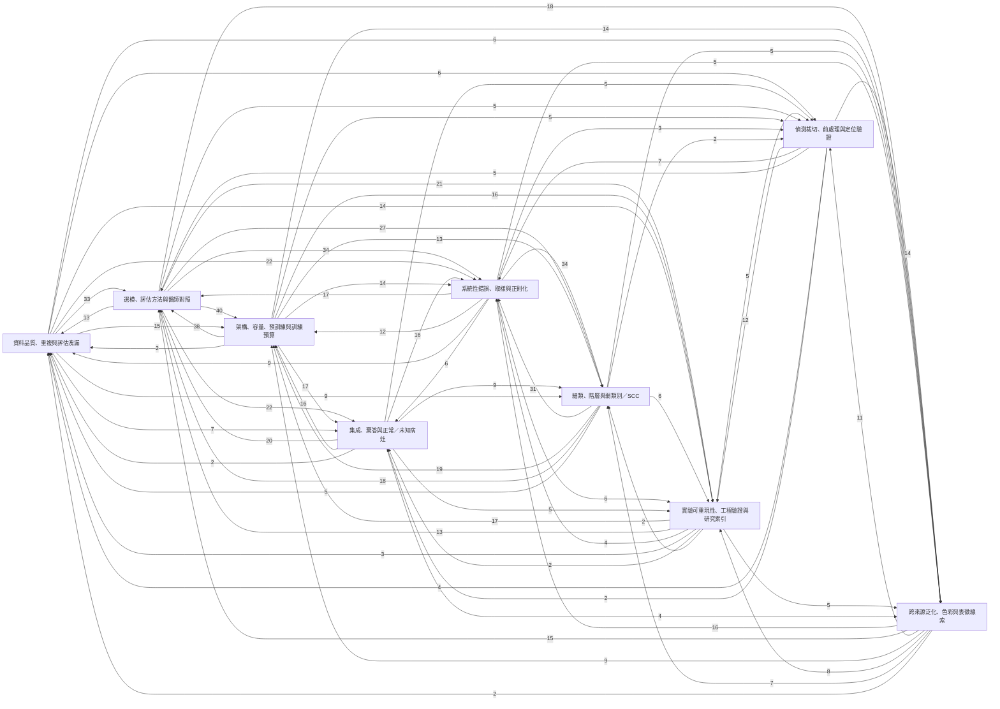
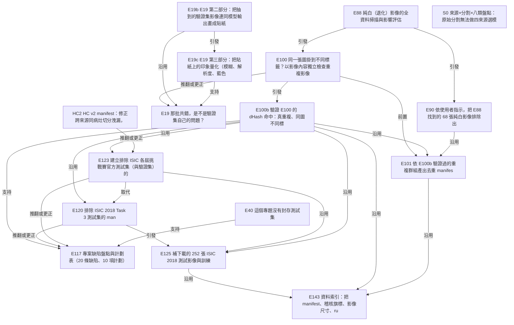
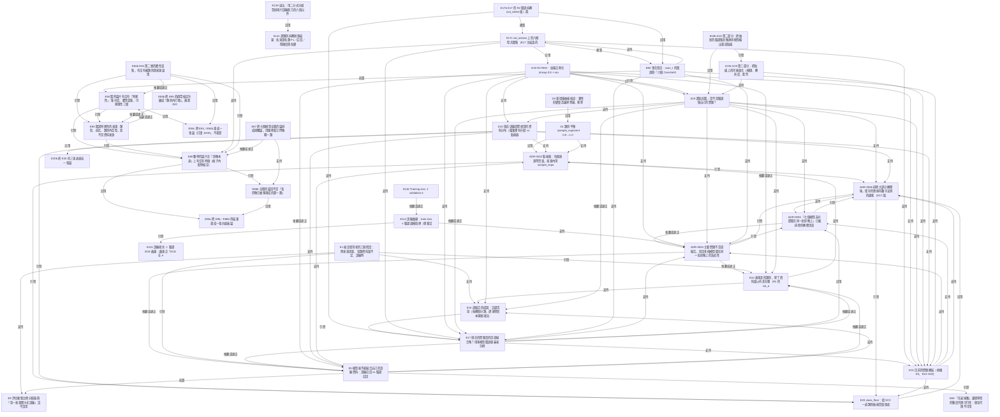
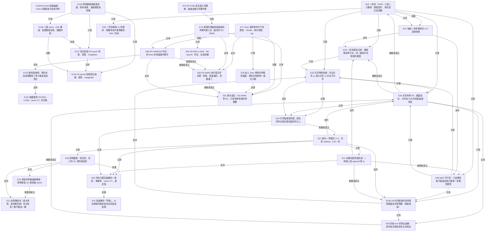
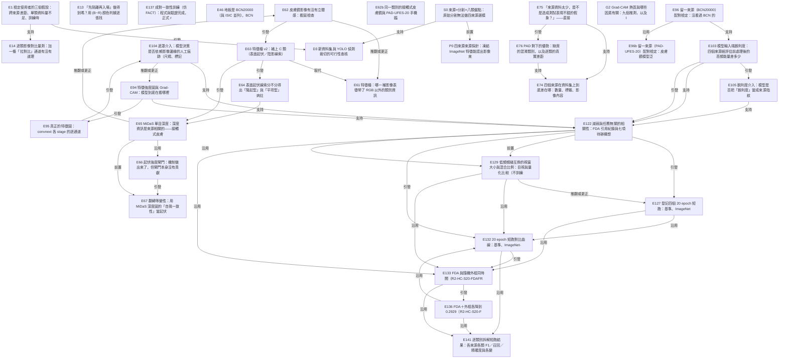
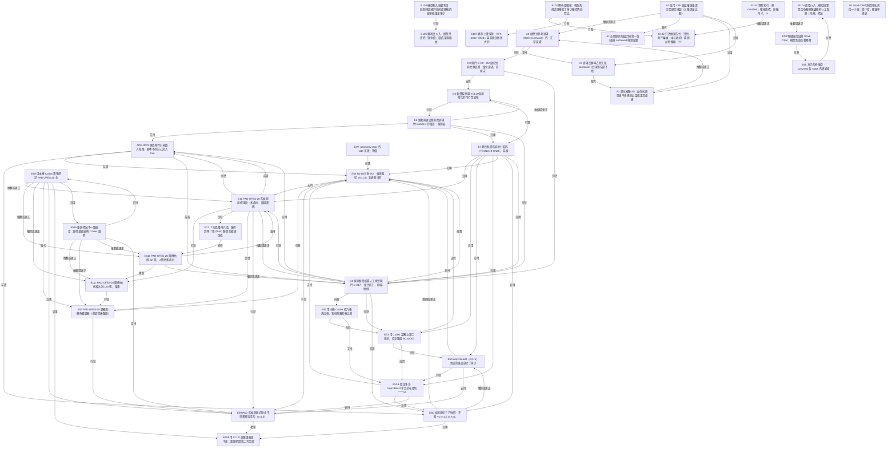
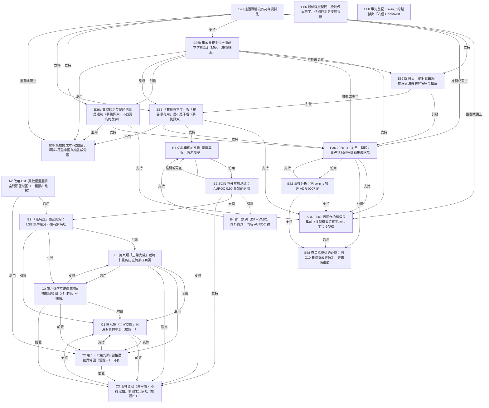
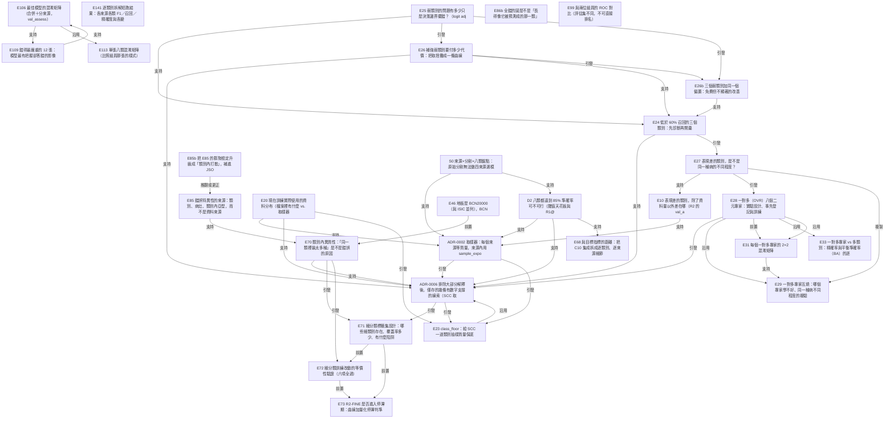

# 實驗族譜

每條關係由實驗頁內文判讀而來（類型、方向、一句理由、出處），全部存在 [`關聯.jsonl`](關聯.jsonl)。
只畫因果類關係（引發、支持、推翻或更正、取代、前置、沿用、複製）；「僅比較」「僅提及」只留在 jsonl。
共 895 條關係，其中因果類 583 條。判讀方式與抽查結果見文末。

## 主題之間

（箭頭上的數字是兩個主題之間的因果關係條數，只畫 ≥2 條的。）

## 資料品質、重複與評估洩漏

從來源與切分盤點、共錯樣本稽核出發，陸續找到純白影像、重新編碼的重複影像與官方測試集混入問題。純白影像與官方測試集已排除，但全面去重 manifest 尚未採用，補下載測試影像的同病灶洩漏仍待下一代 manifest 處理。2026-11-18 另發現 HAM10000 與 ISIC Archive 共用病灶編號造成的跨切分洩漏，HC v2（HC2）排除 642 列修正，之後的實驗都改用 HC v2。

跨主題關係：

- [E19](實驗/E19.md) —支持→ [ADR-0004](實驗/ADR-0004.md)：E19 的七模型共錯統計為 ADR-0004 的系統性錯誤判斷提供證據。
- [E100](實驗/E100.md) —推翻或更正→ [ADR-0005](實驗/ADR-0005.md)：E100 找到內容重複與跨分割同圖，使原本排除洩漏與重複的判斷不成立。
- [E100b](實驗/E100b.md) —推翻或更正→ [ADR-0005](實驗/ADR-0005.md)：E100b 驗證真重複及評估污染，更正原本無重複、無洩漏的判斷。
- [E19](實驗/E19.md) —支持→ [ADR-0005](實驗/ADR-0005.md)：E19 的分層數據支持 ADR-0005 排除多項共錯解釋。
- [E19](實驗/E19.md) —支持→ [ADR-0006](實驗/ADR-0006.md)：E19 量到 BKL 桶內差異與模糊比例差，支持保留這兩條線索。
- [E40](實驗/E40.md) —推翻或更正→ [ADR-0007](實驗/ADR-0007.md)：E40 查明沒有封存測試集，因此 ADR-0007 改寫確認與推翻條件。
- [E19](實驗/E19.md) —支持→ [E10](實驗/E10.md)：E19 共錯率相近，支持 E10 原位鱗癌沒有比較難的判斷。
- [E100b](實驗/E100b.md) —推翻或更正→ [E91](實驗/E91.md)：E100b 證明重複污染墊高 E91 分數，將頭條 F1 更正為 0.6728。
- [E100b](實驗/E100b.md) —推翻或更正→ [E98](實驗/E98.md)：因 E100b 查出評估污染，所以 E98 引用的頭條 F1 下修，AUC 未重算。
- [E100b](實驗/E100b.md) —推翻或更正→ [E106](實驗/E106.md)：因 E100b 查出重複污染，所以 E106 的 0.6819 須附更正值 0.6728。
- [E106](實驗/E106.md) —支持→ [E117](實驗/E117.md)：因 E106 量到 BCN 黑色素瘤誤判為痣，所以支持 E117 列出該缺陷。
- [E107](實驗/E107.md) —支持→ [E117](實驗/E117.md)：因為 E107 因錯誤直譯器立即退出，所以支持排程靜默失敗的缺陷判定。
- [E108](實驗/E108.md) —支持→ [E117](實驗/E117.md)：因為放大分類頭後差距仍在噪聲帶內，所以支持分類頭不是瓶頸的判斷。
- [E100b](實驗/E100b.md) —沿用→ [E109](實驗/E109.md)：因為 E109 使用既有污染與標籤衝突名單，所以能檢查嚴重錯誤是否命中。
- [E100b](實驗/E100b.md) —推翻或更正→ [E110](實驗/E110.md)：因為查到評估集重複污染，所以將模型頭條分數由 0.6819 下修為 0.6728。
- [E117](實驗/E117.md) —支持→ [E110](實驗/E110.md)：因為盤點證實 seed 42 排程失敗，所以支持模型仍只有單一 seed 的限制。
- [E123](實驗/E123.md) —取代→ [E110](實驗/E110.md)：因為後續訓練改採 HC 作對照，所以取代 E110 所記模型的基準地位。
- [E111](實驗/E111.md) —支持→ [E117](實驗/E117.md)：因為索引查出兩代 manifest 混用，所以支持 E117 的缺陷 A4。
- [E120](實驗/E120.md) —推翻或更正→ [E112](實驗/E112.md)：因為建立排除測試集的 manifest，所以修正人機對照實際不可行的判斷。
- [E123](實驗/E123.md) —推翻或更正→ [E112](實驗/E112.md)：因為排除官方測試集並重訓，所以修正人機對照不可行的判斷。
- [E114](實驗/E114.md) —支持→ [E117](實驗/E117.md)：因為確認未記驗證 loss 且無逐 epoch 權重，所以支持缺陷 B6 與補記計劃。
- [E116](實驗/E116.md) —支持→ [E117](實驗/E117.md)：因為量到選模取捨的 pooled BA 代價，所以支持 E117 的缺陷 B1。
- [ADR-0006](實驗/ADR-0006.md) —支持→ [E117](實驗/E117.md)：因為 ADR 提供 SCC 取樣與 BKL 異質的數字，所以支持訓練缺陷盤點。
- [ADR-0007](實驗/ADR-0007.md) —支持→ [E117](實驗/E117.md)：因為 ADR 的集成結果通過判準，所以支持盤點中唯一過關的是集成。
- [E102](實驗/E102.md) —支持→ [E117](實驗/E117.md)：因為稽核量到像素損失與長寬比壓縮，所以支持前處理缺陷盤點。
- [E112](實驗/E112.md) —支持→ [E117](實驗/E117.md)：因為查到官方測試影像大量進入既有資料，所以支持人機對照受污染的限制。
- [E117](實驗/E117.md) —引發→ [E119](實驗/E119.md)：因為盤點發現磁碟僅剩 13G 並列入計劃，所以接著執行磁碟清理。
- [E124](實驗/E124.md) —推翻或更正→ [E117](實驗/E117.md)：因為實際在同組影像上完成人機對照，所以推翻 A6 的不可比較判斷。
- [E120](實驗/E120.md) —引發→ [E121](實驗/E121.md)：因為排除版 manifest 無法由全域路徑逐 run 選用，所以促成覆寫機制實作。
- [E120](實驗/E120.md) —前置→ [E124](實驗/E124.md)：因為 E120 建立官方測試清單與留出流程，所以提供 E124 人機評估的必要前置。
- [E121](實驗/E121.md) —沿用→ [E123](實驗/E123.md)：因為 HC 透過既有逐 run 覆寫功能指定資料，所以沿用 E121 的機制。
- [E123](實驗/E123.md) —沿用→ [E122](實驗/E122.md)：因為構想的後續訓練指定使用 HC manifest，所以沿用 E123 的資料設定。
- [E123](實驗/E123.md) —前置→ [E124](實驗/E124.md)：E123 先留出醫師研究測試集，E124 才能進行人機對照。
- [E123](實驗/E123.md) —沿用→ [E127](實驗/E127.md)：E127 的四個短跑全部使用 E123 產出的排除版 manifest。
- [E123](實驗/E123.md) —沿用→ [E132](實驗/E132.md)：E132 比較的短跑使用 E123 manifest，沿用其資料排除設定。
- [E125](實驗/E125.md) —沿用→ [E124](實驗/E124.md)：E124 使用 E125 的洩漏清單，另算剔除同病灶影像的成績。
- [E123](實驗/E123.md) —前置→ [E126](實驗/E126.md)：E123 確立留出測試集，E126 據此審查預訓練資料是否洩漏。
- [E13](實驗/E13.md) —沿用→ [E19](實驗/E19.md)：E19 沿用 E13 的色差判據，比較共錯與全對影像。
- [E143](實驗/E143.md) —推翻或更正→ [E142](實驗/E142.md)：E143 的全量長寬比統計更正 E142 門檻檔中舊抽樣的背景比例。
- [E19](實驗/E19.md) —推翻或更正→ [E15](實驗/E15.md)：E19 更正 E15 當時把 family 桶視為共錯原因的判斷。
- …另 38 條見 `關聯.jsonl`

## 系統性錯誤、取樣與正則化

從訓練與驗證落差的過擬合解讀，轉向多模型共錯、病灶群聚與類別內異質性的診斷。現有證據支持系統性錯誤是主要瓶頸；短跑減法支持保留類別平衡抽樣、移除一組正則化元件，長跑與跨 seed 確認尚未完成。

跨主題關係：

- [A1](實驗/A1.md) —引發→ [E86](實驗/E86.md)：A1 曾因面積混淆作廢，因此 E86 明確避免面積主張。
- [D1](實驗/D1.md) —引發→ [ADR-0001](實驗/ADR-0001.md)：D1 發現小格指標雜訊造成早停，促成 ge30 指標修訂。
- [E116](實驗/E116.md) —支持→ [ADR-0001](實驗/ADR-0001.md)：E116 量出 pooled BA 代價，支持本指標存在整體表現取捨的判斷。
- [ADR-0002](實驗/ADR-0002.md) —支持→ [ADR-0001](實驗/ADR-0001.md)：取樣後訓練分布與驗證原始分布不同，支持不用準確率選模。
- [D2](實驗/D2.md) —支持→ [ADR-0002](實驗/ADR-0002.md)：D2 的單來源限制支持不應只靠重抽 SCC 解決跨來源問題的判斷。
- [ADR-0004](實驗/ADR-0004.md) —引發→ [ADR-0007](實驗/ADR-0007.md)：ADR-0004 確立模型端改善上限，促成後續尋找真正有效的介入。
- [E38](實驗/E38.md) —推翻或更正→ [ADR-0004](實驗/ADR-0004.md)：E38 證明集成信心能避開共錯，更正 ADR-0004 的棄權決策。
- [E89](實驗/E89.md) —支持→ [ADR-0004](實驗/ADR-0004.md)：Swin 改用 224 解析度仍未改變錯誤結構，支持原共錯判斷。
- [E100](實驗/E100.md) —推翻或更正→ [ADR-0005](實驗/ADR-0005.md)：E100 找到內容重複與跨分割同圖，使原本排除洩漏與重複的判斷不成立。
- [E100b](實驗/E100b.md) —推翻或更正→ [ADR-0005](實驗/ADR-0005.md)：E100b 驗證真重複及評估污染，更正原本無重複、無洩漏的判斷。
- [E27](實驗/E27.md) —推翻或更正→ [ADR-0005](實驗/ADR-0005.md)：E27 量出原位鱗癌的錯判方向差異，使理由改為測得到但無收益。
- [E38](實驗/E38.md) —推翻或更正→ [ADR-0005](實驗/ADR-0005.md)：E38 證明可藉棄答避開共錯，更正清單對棄權一概無效的判斷。
- [ADR-0007](實驗/ADR-0007.md) —支持→ [ADR-0006](實驗/ADR-0006.md)：ADR-0007 彙整共享階梯結果，支持線索四沒有最佳切點的結論。
- [D2](實驗/D2.md) —支持→ [ADR-0006](實驗/ADR-0006.md)：D2 指出 SCC 只有單來源，支持先解決來源問題再考慮重跑的判斷。
- [E24](實驗/E24.md) —支持→ [ADR-0006](實驗/ADR-0006.md)：E24 的弱類別診斷支持降低 SCC 保底取樣改善 F1 的預期。
- [E26](實驗/E26.md) —支持→ [ADR-0006](實驗/ADR-0006.md)：E26 的取捨分析支持提高召回可能犧牲精確率的事前判斷。
- [E28](實驗/E28.md) —引發→ [ADR-0006](實驗/ADR-0006.md)：E28 同時改動共享表徵與 softmax，促成追加拆開歸因的共享線索。
- [ADR-0006](實驗/ADR-0006.md) —引發→ [E32](實驗/E32.md)：為拆開共享骨幹線索的混淆，將四級共享對照寫成 E32 事先登記。
- [E44](實驗/E44.md) —支持→ [ADR-0006](實驗/ADR-0006.md)：E44 完成共享階梯檢驗，支持線索四沒有最佳共享切點的結論。
- [E70](實驗/E70.md) —支持→ [ADR-0006](實驗/ADR-0006.md)：E70 量到類別內異質性，支持線索二繼續檢查標籤桶結構。
- [ADR-0006](實驗/ADR-0006.md) —引發→ [E71](實驗/E71.md)：BKL 桶異質性線索後續發展為 E71 的細分類標籤設計。
- [D1](實驗/D1.md) —引發→ [D2](實驗/D2.md)：D1 發現小樣本格的指標雜訊造成早停，因此 D2 引入 ge30 選模。
- [D1](實驗/D1.md) —沿用→ [E12](實驗/E12.md)：E12 讀取 D1 的 R0 與 R0-BAL logits，統一重算卷積成本比較。
- [E16](實驗/E16.md) —推翻或更正→ [D1](實驗/D1.md)：E16 重算顯示 R0-BAL 到最後仍上升，證明 D1 的大致收斂判讀錯了。
- [D2](實驗/D2.md) —沿用→ [E1](實驗/E1.md)：E1 使用 D2 的 R1 結果與混淆矩陣，檢定跨來源與資料量假設。
- [E1](實驗/E1.md) —引發→ [D3](實驗/D3.md)：E1 推論來源線索是瓶頸，因此促成 D3 優先偵測裁切的排序。
- [E12](實驗/E12.md) —推翻或更正→ [E1](實驗/E1.md)：E12 指出 R2 第 13 輪已走平，因此更正 E1 對延長訓練的判斷。
- [E16](實驗/E16.md) —推翻或更正→ [E1](實驗/E1.md)：E16 以現行指標重算發現末輪最佳，因此修正 E1 的訓練時間判讀。
- [E43](實驗/E43.md) —支持→ [E1](實驗/E1.md)：E43 量到 R2 末段斜率很平，支持 E1 對延長預算收益有限的判斷。
- [E27](實驗/E27.md) —支持→ [E10](實驗/E10.md)：E27 的 Wilson 區間支持 E10 發現的誤判方向差異。
- [E38](實驗/E38.md) —推翻或更正→ [E10](實驗/E10.md)：集成信心能避開多數共錯，更正 E10 棄答無效的概括。
- [E114](實驗/E114.md) —支持→ [E117](實驗/E117.md)：因為確認未記驗證 loss 且無逐 epoch 權重，所以支持缺陷 B6 與補記計劃。
- [E116](實驗/E116.md) —支持→ [E117](實驗/E117.md)：因為量到選模取捨的 pooled BA 代價，所以支持 E117 的缺陷 B1。
- [ADR-0006](實驗/ADR-0006.md) —支持→ [E117](實驗/E117.md)：因為 ADR 提供 SCC 取樣與 BKL 異質的數字，所以支持訓練缺陷盤點。
- [E10](實驗/E10.md) —支持→ [E12](實驗/E12.md)：E10 的類別組成分析支持 E12 對 AKIEC 掉分的當時解釋。
- [E12](實驗/E12.md) —支持→ [E21](實驗/E21.md)：E12 的修正附錄提供共同預算數字，支持 E21 的截斷判斷。
- [E5](實驗/E5.md) —支持→ [E12](實驗/E12.md)：E5 的訓練驗證落差支持 E12 當時優先處理泛化的判斷。
- [E13](實驗/E13.md) —支持→ [E15](實驗/E15.md)：E13 墨跡率與判據偏差，支持 E15 對墨跡捷徑風險的討論。
- [E13](實驗/E13.md) —沿用→ [E19](實驗/E19.md)：E19 沿用 E13 的色差判據，比較共錯與全對影像。
- [E13](實驗/E13.md) —支持→ [E21](實驗/E21.md)：E13 尚未實作形態學判據，支持 E21 將此列為未完成事項。
- …另 52 條見 `關聯.jsonl`

## 架構、容量、預訓練與訓練預算

從增加卷積成本、一對多專家與共享骨幹，延伸到 Swin、KAN、長訓練與 ImageNet-22k。多數介入未取得可辨識的主指標改善；同骨幹提高解析度有正向證據，但仍有 batch 與單一 seed 的限制。

跨主題關係：

- [ADR-0001](實驗/ADR-0001.md) —沿用→ [E12](實驗/E12.md)：E12 使用現行主指標重算舊 run，使不同版本可統一比較。
- [ADR-0001](實驗/ADR-0001.md) —沿用→ [E16](實驗/E16.md)：E16 依 ADR-0001 的現行指標重算舊 run 訓練曲線。
- [E41](實驗/E41.md) —支持→ [ADR-0001](實驗/ADR-0001.md)：E41 的掃描結果支持此 macro 指標應靠近平衡點操作的判斷。
- [E89](實驗/E89.md) —支持→ [ADR-0004](實驗/ADR-0004.md)：Swin 改用 224 解析度仍未改變錯誤結構，支持原共錯判斷。
- [E28](實驗/E28.md) —引發→ [ADR-0006](實驗/ADR-0006.md)：E28 同時改動共享表徵與 softmax，促成追加拆開歸因的共享線索。
- [ADR-0006](實驗/ADR-0006.md) —引發→ [E32](實驗/E32.md)：為拆開共享骨幹線索的混淆，將四級共享對照寫成 E32 事先登記。
- [E44](實驗/E44.md) —支持→ [ADR-0006](實驗/ADR-0006.md)：E44 完成共享階梯檢驗，支持線索四沒有最佳共享切點的結論。
- [E43](實驗/E43.md) —支持→ [ADR-0007](實驗/ADR-0007.md)：E43 確認帶判決的介入已翻頭，支持原先否決判斷不用修改。
- [E44](實驗/E44.md) —推翻或更正→ [ADR-0007](實驗/ADR-0007.md)：E44 更正損失比較應讀的切分與判讀，但未改變集成主決策。
- [E81](實驗/E81.md) —支持→ [ADR-0007](實驗/ADR-0007.md)：跨家族對照未見可辨識增益，支持不再追求更佳單一架構的決策。
- [D1](實驗/D1.md) —沿用→ [E12](實驗/E12.md)：E12 讀取 D1 的 R0 與 R0-BAL logits，統一重算卷積成本比較。
- [E16](實驗/E16.md) —推翻或更正→ [D1](實驗/D1.md)：E16 重算顯示 R0-BAL 到最後仍上升，證明 D1 的大致收斂判讀錯了。
- [D2](實驗/D2.md) —沿用→ [E12](實驗/E12.md)：E12 使用 D2 的 R1 logits，納入統一指標的卷積成本階梯。
- [E12](實驗/E12.md) —推翻或更正→ [E1](實驗/E1.md)：E12 指出 R2 第 13 輪已走平，因此更正 E1 對延長訓練的判斷。
- [E16](實驗/E16.md) —推翻或更正→ [E1](實驗/E1.md)：E16 以現行指標重算發現末輪最佳，因此修正 E1 的訓練時間判讀。
- [E43](實驗/E43.md) —支持→ [E1](實驗/E1.md)：E43 量到 R2 末段斜率很平，支持 E1 對延長預算收益有限的判斷。
- [E100b](實驗/E100b.md) —推翻或更正→ [E91](實驗/E91.md)：E100b 證明重複污染墊高 E91 分數，將頭條 F1 更正為 0.6728。
- [E102](實驗/E102.md) —引發→ [E142](實驗/E142.md)：因 E102 發現評估壓扁長寬比，所以 E142 檢驗只改推論的改善方式。
- [E102](實驗/E102.md) —引發→ [E107](實驗/E107.md)：因為稽核發現像素大量流失，所以提出高解析度訓練顯存探測。
- [E108](實驗/E108.md) —前置→ [E107](實驗/E107.md)：因為顯存探測須等 KAN 完成並釋放 GPU，所以完成訊號是排程閘門。
- [E108](實驗/E108.md) —支持→ [E117](實驗/E117.md)：因為放大分類頭後差距仍在噪聲帶內，所以支持分類頭不是瓶頸的判斷。
- [E108](實驗/E108.md) —支持→ [E134](實驗/E134.md)：因為 KAN 的改善未超出噪聲，所以支持引用總表中分類頭不是瓶頸的判斷。
- [E100b](實驗/E100b.md) —推翻或更正→ [E110](實驗/E110.md)：因為查到評估集重複污染，所以將模型頭條分數由 0.6819 下修為 0.6728。
- [E117](實驗/E117.md) —支持→ [E110](實驗/E110.md)：因為盤點證實 seed 42 排程失敗，所以支持模型仍只有單一 seed 的限制。
- [E123](實驗/E123.md) —取代→ [E110](實驗/E110.md)：因為後續訓練改採 HC 作對照，所以取代 E110 所記模型的基準地位。
- [E102](實驗/E102.md) —支持→ [E117](實驗/E117.md)：因為稽核量到像素損失與長寬比壓縮，所以支持前處理缺陷盤點。
- [E10](實驗/E10.md) —支持→ [E12](實驗/E12.md)：E10 的類別組成分析支持 E12 對 AKIEC 掉分的當時解釋。
- [E14](實驗/E14.md) —支持→ [E12](實驗/E12.md)：逐類對比與召回不一致，支持 E12 不加對比通道的判斷。
- [E12](實驗/E12.md) —支持→ [E21](實驗/E21.md)：E12 的修正附錄提供共同預算數字，支持 E21 的截斷判斷。
- [E5](實驗/E5.md) —支持→ [E12](實驗/E12.md)：E5 的訓練驗證落差支持 E12 當時優先處理泛化的判斷。
- [E121](實驗/E121.md) —沿用→ [E128](實驗/E128.md)：因為新 opt-in 驗證沿用既有 cfg 等價性檢查方式，所以延續 E121 的驗證設定。
- [E102](實驗/E102.md) —引發→ [E122](實驗/E122.md)：因為稽核量到長寬比壓縮，所以構想表提出保持長寬比的前處理。
- [E122](實驗/E122.md) —引發→ [E127](實驗/E127.md)：因為 FDA 與隨機外框構想獲同意，所以登記對應的短跑實驗。
- [E122](實驗/E122.md) —引發→ [E128](實驗/E128.md)：因為要實作 FDA 與外框構想，所以需要驗證新增 opt-in 功能與預設等價性。
- [E122](實驗/E122.md) —引發→ [E132](實驗/E132.md)：因為先提出並同意 FDA 與外框構想，所以後續以短跑比較其效果。
- [E123](實驗/E123.md) —沿用→ [E127](實驗/E127.md)：E127 的四個短跑全部使用 E123 產出的排除版 manifest。
- [E123](實驗/E123.md) —沿用→ [E132](實驗/E132.md)：E132 比較的短跑使用 E123 manifest，沿用其資料排除設定。
- [E123](實驗/E123.md) —前置→ [E126](實驗/E126.md)：E123 確立留出測試集，E126 據此審查預訓練資料是否洩漏。
- [E129](實驗/E129.md) —推翻或更正→ [E127](實驗/E127.md)：E129 比較影像偽結構後，修正 E127 尚未啟動的 FDA 設定。
- [E127](實驗/E127.md) —沿用→ [E131](實驗/E131.md)：E131 複用 E127 四個短跑設定，只調整 batch 與梯度累積。
- …另 66 條見 `關聯.jsonl`

## 跨來源泛化、色彩與表徵線索

從來源探針與來源間差距，追查色彩、銳利度、邊緣痕跡與深度線索，再以留一來源及 FDA／外框介入檢驗。留一 PAD 顯示明顯跨模態落差；FDA 僅有來源限定的短跑訊號，尚未證實整體改善。

跨主題關係：

- [B2](實驗/B2.md) —支持→ [D3](實驗/D3.md)：B2 量到臨床照的域偏移，因此作為 D3 評估外部資料風險的依據。
- [D2](實驗/D2.md) —引發→ [D3](實驗/D3.md)：D2 顯示 AKIEC 與 SCC 召回落後，因此 D3 查核新資料與偵測裁切方案。
- [D2](實驗/D2.md) —沿用→ [E1](實驗/E1.md)：E1 使用 D2 的 R1 結果與混淆矩陣，檢定跨來源與資料量假設。
- [D3](實驗/D3.md) —引發→ [E6](實驗/E6.md)：D3 提出偵測裁切路線，因此 E6 先盤點可供分割器學習的遮罩。
- [D3](實驗/D3.md) —引發→ [E7](實驗/E7.md)：D3 提出偵測後裁切分類，因此 E7 訓練分割器產生全資料病灶框。
- [R0](實驗/R0.md) —支持→ [D3](實驗/D3.md)：R0 的啟發式框目視未通過，支持 D3 判定不能拿這些框訓練 YOLO。
- [E1](實驗/E1.md) —引發→ [E10](實驗/E10.md)：E1 已指出張數不決定表現，因此 E10 進一步查類別真正的分界線。
- [E12](實驗/E12.md) —推翻或更正→ [E1](實驗/E1.md)：E12 指出 R2 第 13 輪已走平，因此更正 E1 對延長訓練的判斷。
- [E16](實驗/E16.md) —推翻或更正→ [E1](實驗/E1.md)：E16 以現行指標重算發現末輪最佳，因此修正 E1 的訓練時間判讀。
- [E43](實驗/E43.md) —支持→ [E1](實驗/E1.md)：E43 量到 R2 末段斜率很平，支持 E1 對延長預算收益有限的判斷。
- [E1](實驗/E1.md) —引發→ [E5](實驗/E5.md)：E1 提出先量訓練集召回，因此 E5 執行訓練集推論檢定。
- [E1](實驗/E1.md) —支持→ [E9](實驗/E9.md)：E1 的互相混淆數字支持 E9 判定調整份量會牽動共同決策邊界。
- [E11](實驗/E11.md) —引發→ [E13](實驗/E13.md)：E11 的墨跡風險與隔離方案，促成 E13 測逐張辨識判據。
- [E13](實驗/E13.md) —支持→ [E11b](實驗/E11b.md)：E13 分層估計與 E11b 墨跡率同範圍，提供另一方法的支持。
- [E14](實驗/E14.md) —支持→ [E12](實驗/E12.md)：逐類對比與召回不一致，支持 E12 不加對比通道的判斷。
- [E102](實驗/E102.md) —引發→ [E122](實驗/E122.md)：因為稽核量到長寬比壓縮，所以構想表提出保持長寬比的前處理。
- [E123](實驗/E123.md) —沿用→ [E122](實驗/E122.md)：因為構想的後續訓練指定使用 HC manifest，所以沿用 E123 的資料設定。
- [E122](實驗/E122.md) —引發→ [E128](實驗/E128.md)：因為要實作 FDA 與外框構想，所以需要驗證新增 opt-in 功能與預設等價性。
- [E134](實驗/E134.md) —支持→ [E122](實驗/E122.md)：因為補核 FDA 的正式發表會議，所以支持構想頁後補的書目資訊。
- [E135](實驗/E135.md) —支持→ [E122](實驗/E122.md)：因為資料庫確認兩版本頁碼不同，所以支持引用時區分 IEEE 與 CVF 版本。
- [E123](實驗/E123.md) —沿用→ [E127](實驗/E127.md)：E127 的四個短跑全部使用 E123 產出的排除版 manifest。
- [E123](實驗/E123.md) —沿用→ [E132](實驗/E132.md)：E132 比較的短跑使用 E123 manifest，沿用其資料排除設定。
- [E126](實驗/E126.md) —引發→ [E127](實驗/E127.md)：E126 查證後選定 ImageNet-22k，促成 E127 登記對照短跑。
- [E126](實驗/E126.md) —引發→ [E132](實驗/E132.md)：E126 導向 ImageNet-22k 對照，E132 隨後實測其短跑表現。
- [E128](實驗/E128.md) —前置→ [E127](實驗/E127.md)：E128 驗證通過是 E127 套用新程式與啟動短跑的閘門。
- [E127](實驗/E127.md) —沿用→ [E131](實驗/E131.md)：E131 複用 E127 四個短跑設定，只調整 batch 與梯度累積。
- [E128](實驗/E128.md) —引發→ [E129](實驗/E129.md)：E128 範例圖出現假團塊與色斑，促成 E129 比較並調整 FDA 設定。
- [E128](實驗/E128.md) —前置→ [E132](實驗/E132.md)：E128 驗證新功能並套用新程式後，FDA 與 FRAME 短跑才能正確執行。
- [E13](實驗/E13.md) —支持→ [E15](實驗/E15.md)：E13 墨跡率與判據偏差，支持 E15 對墨跡捷徑風險的討論。
- [E13](實驗/E13.md) —沿用→ [E19](實驗/E19.md)：E19 沿用 E13 的色差判據，比較共錯與全對影像。
- [E13](實驗/E13.md) —支持→ [E21](實驗/E21.md)：E13 尚未實作形態學判據，支持 E21 將此列為未完成事項。
- [E5](實驗/E5.md) —支持→ [E13](實驗/E13.md)：E5 量到高重複曝光，支持 E13 對移除訓練影像成本的警告。
- [D3](實驗/D3.md) —沿用→ [E134](實驗/E134.md)：E134 收集 D3 中散落的文獻，整理為引用與實驗對照資料。
- [E122](實驗/E122.md) —沿用→ [E134](實驗/E134.md)：E134 收集 E122 的 FDA 文獻紀錄，彙成引用與實驗對照資料。
- [E133](實驗/E133.md) —沿用→ [E134](實驗/E134.md)：E134 在 E133 完成後收錄其成績，補上原先尚無結果的項目。
- [E137](實驗/E137.md) —沿用→ [E139](實驗/E139.md)：E139 以 E137 暫存版程式為基礎，再加入減法實驗的開關。
- [E139](實驗/E139.md) —沿用→ [E141](實驗/E141.md)：E141 使用 E139 的 BARE 與 NOREG 結果，拆解逐類效應。
- [E10](實驗/E10.md) —引發→ [E14](實驗/E14.md)：E10 排除資料量解釋，促成 E14 檢查弱類別是否對比較低。
- [E1](實驗/E1.md) —支持→ [E15](實驗/E15.md)：E1 的來源線索量測支持 E15 把來源指紋列為專題風險。
- [E13](實驗/E13.md) —沿用→ [E19c](實驗/E19c.md)：E19c 使用 E13 的顏色門檻，因此以藍色像素比例作為量測指標。
- …另 16 條見 `關聯.jsonl`

## 偵測裁切、前處理與定位驗證

從啟發式框與遮罩失敗，建立分割器、人工視覺閘門及兩種裁切強度對照，同時修正空間圖讀出與前處理問題。現有偵測裁切不採用；只改推論的保持長寬比與 TTA 也未通過採用規則，保持長寬比重訓仍未執行。

跨主題關係：

- [A1](實驗/A1.md) —引發→ [E86](實驗/E86.md)：A1 曾因面積混淆作廢，因此 E86 明確避免面積主張。
- [A2](實驗/A2.md) —沿用→ [B3](實驗/B3.md)：B3 使用 A2 的 LSE 讀出檢驗有無病灶的判別能力。
- [B2](實驗/B2.md) —支持→ [D3](實驗/D3.md)：B2 量到臨床照的域偏移，因此作為 D3 評估外部資料風險的依據。
- [A2](實驗/A2.md) —沿用→ [C2](實驗/C2.md)：C2 沿用 A2 的評分方法與舊軸數字，評估新的第九類異常圖。
- [D2](實驗/D2.md) —引發→ [D3](實驗/D3.md)：D2 顯示 AKIEC 與 SCC 召回落後，因此 D3 查核新資料與偵測裁切方案。
- [E1](實驗/E1.md) —引發→ [D3](實驗/D3.md)：E1 推論來源線索是瓶頸，因此促成 D3 優先偵測裁切的排序。
- [E89](實驗/E89.md) —支持→ [E102](實驗/E102.md)：因 E89 提供同骨幹解析度差，所以支持 E102 解析度可換分數的判斷。
- [E103](實驗/E103.md) —支持→ [E122](實驗/E122.md)：因 E103 量到來源銳利度差，所以支持 E122 將其列為可減弱的差異。
- [E96](實驗/E96.md) —支持→ [E103](實驗/E103.md)：因留一 BCN 幾乎不掉分，所以 E103 將其視為來源辨識假說的相容現象。
- [E104](實驗/E104.md) —支持→ [E122](實驗/E122.md)：因 E104 未發現普遍邊框依賴，所以支持 E122 對既有證據的保留判斷。
- [E105](實驗/E105.md) —支持→ [E122](實驗/E122.md)：因 E105 未發現銳利度依賴，所以支持 E122 對該擴充證據限制的記錄。
- [E108](實驗/E108.md) —前置→ [E107](實驗/E107.md)：因為顯存探測須等 KAN 完成並釋放 GPU，所以完成訊號是排程閘門。
- [E107](實驗/E107.md) —支持→ [E117](實驗/E117.md)：因為 E107 因錯誤直譯器立即退出，所以支持排程靜默失敗的缺陷判定。
- [E102](實驗/E102.md) —支持→ [E110](實驗/E110.md)：因為稽核量到長寬比壓縮，所以支持超參數文件揭露評估前處理缺陷。
- [E102](實驗/E102.md) —支持→ [E117](實驗/E117.md)：因為稽核量到像素損失與長寬比壓縮，所以支持前處理缺陷盤點。
- [E102](實驗/E102.md) —引發→ [E122](實驗/E122.md)：因為稽核量到長寬比壓縮，所以構想表提出保持長寬比的前處理。
- [E103](實驗/E103.md) —引發→ [E122](實驗/E122.md)：因為來源間高頻能量差達 4.2 倍，所以列出隨機模糊與銳化構想。
- [E94](實驗/E94.md) —支持→ [E122](實驗/E122.md)：因為尺標捷徑主張已撤回，所以支持構想表不把它列為已證實的依賴。
- [E125](實驗/E125.md) —沿用→ [E143](實驗/E143.md)：E143 把 E125 找出的同病灶資料收進 flags 表。
- [E13](實驗/E13.md) —支持→ [E15](實驗/E15.md)：E13 墨跡率與判據偏差，支持 E15 對墨跡捷徑風險的討論。
- [E13](實驗/E13.md) —沿用→ [E19](實驗/E19.md)：E19 沿用 E13 的色差判據，比較共錯與全對影像。
- [E13](實驗/E13.md) —支持→ [E21](實驗/E21.md)：E13 尚未實作形態學判據，支持 E21 將此列為未完成事項。
- [E5](實驗/E5.md) —支持→ [E13](實驗/E13.md)：E5 量到高重複曝光，支持 E13 對移除訓練影像成本的警告。
- [D3](實驗/D3.md) —沿用→ [E134](實驗/E134.md)：E134 收集 D3 中散落的文獻，整理為引用與實驗對照資料。
- [E100b](實驗/E100b.md) —沿用→ [E143](實驗/E143.md)：E143 將 E100b 的同圖與異標籤稽核結果收進 flags 表。
- [E101](實驗/E101.md) —沿用→ [E143](實驗/E143.md)：E143 使用 E101 的去重排除資料建立旗標，未將去重 manifest 改為訓練版本。
- [E11](實驗/E11.md) —支持→ [E15](實驗/E15.md)：E11 發現偵測框跟隨墨跡，支持 E15 對裁切鎖入捷徑的警告。
- [E13](實驗/E13.md) —沿用→ [E19c](實驗/E19c.md)：E19c 使用 E13 的顏色門檻，因此以藍色像素比例作為量測指標。
- [E49](實驗/E49.md) —推翻或更正→ [E42](實驗/E42.md)：因為超大影像在偵測裁切下造成崩潰，所以更正 E42 的無須改動判斷。
- [E94](實驗/E94.md) —支持→ [E45](實驗/E45.md)：因為後續更正仍記載評估使用 draft，所以支持 E45 對其持續存在的註記。
- [E1](實驗/E1.md) —引發→ [E7](實驗/E7.md)：E1 推論模型使用來源線索，因此 E7 產生病灶框以支援移除這些線索。
- [A1](實驗/A1.md) —支持→ [E86](實驗/E86.md)：因 A1 的面積比較已作廢，所以支持 E86 不作面積主張的決定。
- [E91](實驗/E91.md) —沿用→ [E94](實驗/E94.md)：因 E91 產出最佳模型，所以 E94 使用其 ep51 權重繪製歸因圖。
- [E94](實驗/E94.md) —引發→ [E97](實驗/E97.md)：因 E94 曾用錯前處理，所以 E97 加入重算 logits 的自我驗證規則。
- [S0](實驗/S0.md) —支持→ [D3](實驗/D3.md)：因為 S0 顯示 SCC 僅有一個來源，所以支持 D3 引入外部 SCC 資料的建議。
- [G1](實驗/G1.md) —引發→ [G2](實驗/G2.md)：G1 確認熱區高度集中後，才進一步檢查熱區型態與哪些因素有關。
- [HC2](實驗/HC2.md) —前置→ [G1](實驗/G1.md)：G1 的 HC v2 重跑使用 HC2 的 seed 17 基準權重。

## 集成、棄答與正常／未知病灶

從信心棄答與界外偵測，分化出正常皮膚第九類及模型集成兩條線。集成在舊 manifest 有增益，並可配合棄答避開共錯；第九類的成功限於影像層級，可靠未知病灶偵測與現行 manifest 的集成確認仍未完成。

跨主題關係：

- [A2](實驗/A2.md) —推翻或更正→ [A0](實驗/A0.md)：A2 揭露少量目視下結論的問題，使 A0 目視宣稱降級。
- [A2](實驗/A2.md) —取代→ [A1](實驗/A1.md)：A1 讀出方式錯誤而作廢，改由 A2 的正確讀出版本取代。
- [A2](實驗/A2.md) —沿用→ [A3](實驗/A3.md)：A3 使用 A2 的 LSE 讀出作為病灶位置代理。
- [A2](實驗/A2.md) —沿用→ [A4](實驗/A4.md)：A4 使用 A2 的 LSE 貢獻圖估計病灶位置。
- [ADR-0001](實驗/ADR-0001.md) —沿用→ [ADR-0007](實驗/ADR-0007.md)：ADR-0007 沿用 ADR-0001 定義的主指標判斷介入成效。
- [ADR-0004](實驗/ADR-0004.md) —引發→ [ADR-0007](實驗/ADR-0007.md)：ADR-0004 確立模型端改善上限，促成後續尋找真正有效的介入。
- [E38](實驗/E38.md) —推翻或更正→ [ADR-0004](實驗/ADR-0004.md)：E38 證明集成信心能避開共錯，更正 ADR-0004 的棄權決策。
- [E80](實驗/E80.md) —支持→ [ADR-0004](實驗/ADR-0004.md)：不同家族的 Swin 也少能修掉共錯，支持系統性錯誤並非家族特例。
- [E38](實驗/E38.md) —推翻或更正→ [ADR-0005](實驗/ADR-0005.md)：E38 證明可藉棄答避開共錯，更正清單對棄權一概無效的判斷。
- [ADR-0007](實驗/ADR-0007.md) —支持→ [ADR-0006](實驗/ADR-0006.md)：ADR-0007 彙整共享階梯結果，支持線索四沒有最佳切點的結論。
- [E43](實驗/E43.md) —支持→ [ADR-0007](實驗/ADR-0007.md)：E43 確認帶判決的介入已翻頭，支持原先否決判斷不用修改。
- [E44](實驗/E44.md) —推翻或更正→ [ADR-0007](實驗/ADR-0007.md)：E44 更正損失比較應讀的切分與判讀，但未改變集成主決策。
- [E81](實驗/E81.md) —支持→ [ADR-0007](實驗/ADR-0007.md)：跨家族對照未見可辨識增益，支持不再追求更佳單一架構的決策。
- [B2](實驗/B2.md) —支持→ [D3](實驗/D3.md)：B2 量到臨床照的域偏移，因此作為 D3 評估外部資料風險的依據。
- [E38](實驗/E38.md) —推翻或更正→ [E10](實驗/E10.md)：集成信心能避開多數共錯，更正 E10 棄答無效的概括。
- [E111](實驗/E111.md) —推翻或更正→ [ADR-0007](實驗/ADR-0007.md)：因為索引揭露集成增益來自舊 manifest，所以修正其適用於現行資料的判讀。
- [ADR-0007](實驗/ADR-0007.md) —支持→ [E117](實驗/E117.md)：因為 ADR 的集成結果通過判準，所以支持盤點中唯一過關的是集成。
- [E40](實驗/E40.md) —支持→ [E117](實驗/E117.md)：因為事實查核確認沒有封存測試集，所以支持結果可信度缺陷 A5。
- [B2](實驗/B2.md) —支持→ [E15](實驗/E15.md)：B2 的域偏移判定支持 E15 將分布位移與過擬合分開討論。
- [E38](實驗/E38.md) —推翻或更正→ [E17](實驗/E17.md)：集成信心能避開共錯，將 E17 棄權無效限縮為 R2 自己的信心。
- [E80](實驗/E80.md) —支持→ [E17](實驗/E17.md)：非 ConvNeXt 模型仍難修共錯，支持 E17 結論不限於同家族模型。
- [E17c](實驗/E17c.md) —複製→ [E38](實驗/E38.md)：E38 用獨立管線重算共錯，確認 E17c 數字與對齊管線一致。
- [E17c](實驗/E17c.md) —複製→ [E80](實驗/E80.md)：E80 重算六模型共錯集作對帳，再加入異家族模型檢驗。
- [E36](實驗/E36.md) —推翻或更正→ [E21](實驗/E21.md)：E36 的集成取得顯著進步，因此更正 E21 尚未兌現模型端空間的盤點。
- [E38](實驗/E38.md) —推翻或更正→ [E21](實驗/E21.md)：E38 區分集成信心與單模型信心，因此將 E21 棄權救不了的說法加上條件。
- [E80](實驗/E80.md) —支持→ [E21](實驗/E21.md)：E80 換用 Swin 仍看到共錯現象，因此支持 E21 的系統性錯誤判斷。
- [E36](實驗/E36.md) —推翻或更正→ [E23](實驗/E23.md)：E36 時段指出加抽不能補跨來源訊號，因此修正 E23 的重跑建議。
- [E36](實驗/E36.md) —支持→ [E25](實驗/E25.md)：E36 時段補充 softmax 分數已同尺度，因此支持 E25 的先驗調整無收益判斷。
- [E32](實驗/E32.md) —沿用→ [E36](實驗/E36.md)：因 E32 定義共享階梯，E36 時段沿用設計完成 S3 與 S2。
- [E34](實驗/E34.md) —沿用→ [E35](實驗/E35.md)：因 E34 產出 S4，E35 沿用其分數繪製四個 arm 的比較曲線。
- [E36](實驗/E36.md) —取代→ [E34](實驗/E34.md)：因歷史對照不乾淨，E36 時段改用同腳本配對 2×2 取代它。
- [E34b](實驗/E34b.md) —沿用→ [E35](實驗/E35.md)：因 E34b 產出 S4-D 校準分數，E35 用它跨頭比較風險與覆蓋率。
- [E34b](實驗/E34b.md) —沿用→ [E36](實驗/E36.md)：因 E34b 產出 S4-D，E36 將其加入集成池與混合棄答。
- [E35](實驗/E35.md) —推翻或更正→ [E34](實驗/E34.md)：E35 掃遍門檻後，將 E34 的資訊取不出來收緊為單一門檻皆無效。
- [E36](實驗/E36.md) —支持→ [E17](實驗/E17.md)：E36 整理集成幾乎修不了共錯，支持 E17 對系統性錯誤的判斷。
- [E34](實驗/E34.md) —引發→ [E36](實驗/E36.md)：因 E34 歷史對照不乾淨，E36 登記同腳本 CE／BCE 配對實驗。
- [E36](實驗/E36.md) —前置→ [E37](實驗/E37.md)：因 E36 在跑格子前登記事先判準，E37 依此執行配對 2×2。
- [E44](實驗/E44.md) —推翻或更正→ [E36](實驗/E36.md)：E44 指出損失判決讀錯切分，更正 E36 對共用 softmax 的結案判斷。
- [E40](實驗/E40.md) —支持→ [E37](實驗/E37.md)：E40 盤點多支分析讀取評估集，支持 E37 對分岔路徑風險的限制。
- [E17](實驗/E17.md) —沿用→ [E38](實驗/E38.md)：因為要重建共錯集，所以 E38 使用 E17 的六個模型。
- …另 29 條見 `關聯.jsonl`

## 細類、階層與弱類別／SCC

從 SCC 單來源與抽樣上限、弱類別的召回／精確度取捨，追到病程譜與 family 桶內異質性。細分類設計已實作，但 SCC 保底實驗未跑完、R2-FINE 停於 epoch 16，尚無完成實驗證明這些處方能改善八類表現。

跨主題關係：

- [ADR-0002](實驗/ADR-0002.md) —支持→ [ADR-0001](實驗/ADR-0001.md)：取樣後訓練分布與驗證原始分布不同，支持不用準確率選模。
- [D1](實驗/D1.md) —沿用→ [ADR-0002](實驗/ADR-0002.md)：ADR-0002 沿用 D1 採用的取樣指數與修正後來源等權公式。
- [E5](實驗/E5.md) —支持→ [ADR-0002](實驗/ADR-0002.md)：E5 的重複曝光數與後續獨立計算吻合，支持取樣副作用數字。
- [ADR-0004](實驗/ADR-0004.md) —推翻或更正→ [E10](實驗/E10.md)：共錯診斷與正則化驗證更正 E10 將主因歸為過擬合的解讀。
- [ADR-0006](實驗/ADR-0006.md) —支持→ [ADR-0005](實驗/ADR-0005.md)：BKL 桶內異質性的數字支持排除旗標效應不等於標籤本體無問題。
- [E27](實驗/E27.md) —推翻或更正→ [ADR-0005](實驗/ADR-0005.md)：E27 量出原位鱗癌的錯判方向差異，使理由改為測得到但無收益。
- [ADR-0004](實驗/ADR-0004.md) —引發→ [ADR-0006](實驗/ADR-0006.md)：ADR-0004 限定模型端改善空間，促成對剩餘可操作線索的排序。
- [ADR-0005](實驗/ADR-0005.md) —引發→ [ADR-0006](實驗/ADR-0006.md)：ADR-0005 排掉多數解釋，因此 ADR-0006 轉向整理剩餘線索。
- [ADR-0007](實驗/ADR-0007.md) —支持→ [ADR-0006](實驗/ADR-0006.md)：ADR-0007 彙整共享階梯結果，支持線索四沒有最佳切點的結論。
- [E19](實驗/E19.md) —支持→ [ADR-0006](實驗/ADR-0006.md)：E19 量到 BKL 桶內差異與模糊比例差，支持保留這兩條線索。
- [E21](實驗/E21.md) —支持→ [ADR-0006](實驗/ADR-0006.md)：E21 整理三條可量化線索，支持 ADR-0006 的研究方向排序。
- [ADR-0006](實驗/ADR-0006.md) —引發→ [E32](實驗/E32.md)：為拆開共享骨幹線索的混淆，將四級共享對照寫成 E32 事先登記。
- [E44](實驗/E44.md) —支持→ [ADR-0006](實驗/ADR-0006.md)：E44 完成共享階梯檢驗，支持線索四沒有最佳共享切點的結論。
- [D1](實驗/D1.md) —支持→ [ADR-0002](實驗/ADR-0002.md)：D1 的兩 seed 結果促成採用指數 1.0，支持 ADR 記錄的現行取樣設定。
- [D1](實驗/D1.md) —引發→ [D2](實驗/D2.md)：D1 發現小樣本格的指標雜訊造成早停，因此 D2 引入 ge30 選模。
- [D2](實驗/D2.md) —引發→ [D3](實驗/D3.md)：D2 顯示 AKIEC 與 SCC 召回落後，因此 D3 查核新資料與偵測裁切方案。
- [D2](實驗/D2.md) —沿用→ [E1](實驗/E1.md)：E1 使用 D2 的 R1 結果與混淆矩陣，檢定跨來源與資料量假設。
- [D2](實驗/D2.md) —沿用→ [E12](實驗/E12.md)：E12 使用 D2 的 R1 logits，納入統一指標的卷積成本階梯。
- [E1](實驗/E1.md) —引發→ [E10](實驗/E10.md)：E1 已指出張數不決定表現，因此 E10 進一步查類別真正的分界線。
- [E17](實驗/E17.md) —推翻或更正→ [E10](實驗/E10.md)：E17 的共錯檢定推翻 E10 的教科書式過擬合解釋。
- [E18](實驗/E18.md) —推翻或更正→ [E10](實驗/E10.md)：加強正則化未帶來明確改善，更正了 E10 的對症處方。
- [E19](實驗/E19.md) —支持→ [E10](實驗/E10.md)：E19 共錯率相近，支持 E10 原位鱗癌沒有比較難的判斷。
- [E38](實驗/E38.md) —推翻或更正→ [E10](實驗/E10.md)：集成信心能避開多數共錯，更正 E10 棄答無效的概括。
- [E5](實驗/E5.md) —推翻或更正→ [E10](實驗/E10.md)：E5 量到高訓練召回，推翻 E10 表徵沒分出類別的解釋。
- [E100b](實驗/E100b.md) —推翻或更正→ [E106](實驗/E106.md)：因 E100b 查出重複污染，所以 E106 的 0.6819 須附更正值 0.6728。
- [E106](實驗/E106.md) —支持→ [E117](實驗/E117.md)：因 E106 量到 BCN 黑色素瘤誤判為痣，所以支持 E117 列出該缺陷。
- [E100b](實驗/E100b.md) —沿用→ [E109](實驗/E109.md)：因為 E109 使用既有污染與標籤衝突名單，所以能檢查嚴重錯誤是否命中。
- [ADR-0006](實驗/ADR-0006.md) —支持→ [E117](實驗/E117.md)：因為 ADR 提供 SCC 取樣與 BKL 異質的數字，所以支持訓練缺陷盤點。
- [E10](實驗/E10.md) —支持→ [E12](實驗/E12.md)：E10 的類別組成分析支持 E12 對 AKIEC 掉分的當時解釋。
- [E132](實驗/E132.md) —沿用→ [E141](實驗/E141.md)：E141 使用 E132 所整理的短跑結果，進一步拆解來源與類別效應。
- [E133](實驗/E133.md) —沿用→ [E141](實驗/E141.md)：E141 使用 E133 的 FDAFRAME 結果，分析逐類效應。
- [E136](實驗/E136.md) —沿用→ [E141](實驗/E141.md)：E141 使用 E136 的 P29 短跑結果，分析逐類效應。
- [E139](實驗/E139.md) —沿用→ [E141](實驗/E141.md)：E141 使用 E139 的 BARE 與 NOREG 結果，拆解逐類效應。
- [E10](實驗/E10.md) —引發→ [E14](實驗/E14.md)：E10 排除資料量解釋，促成 E14 檢查弱類別是否對比較低。
- [E10](實驗/E10.md) —支持→ [E15](實驗/E15.md)：E10 排除資料量主因，支持 E15 對有效樣本不足解釋的限制。
- [E27](實驗/E27.md) —推翻或更正→ [E19](實驗/E19.md)：E27 測得顯著錯誤方向，因此將 E19 的無證據說法修正為測得到但無收益。
- [E70](實驗/E70.md) —推翻或更正→ [E19](實驗/E19.md)：E70 測得原位鱗癌偏向 SCC 的顯著差異，因此補正 E19 的無證據說法。
- [E18](實驗/E18.md) —支持→ [E20](實驗/E20.md)：E18 顯示正則化削掉重複小格的訓練召回，因此支撐 E20 的必要記憶解讀。
- [E19](實驗/E19.md) —支持→ [E20](實驗/E20.md)：E19 顯示 BKL 次類行為不同，因此支持 E20 指出八類彙總的限制。
- [E20](實驗/E20.md) —沿用→ [E20b](實驗/E20b.md)：E20b 讀取 E20 的分布 JSON，因此將既有計算結果繪成圖。
- …另 38 條見 `關聯.jsonl`

## 選模、評估方法與醫師對照

從小樣本格造成的選模雜訊，建立最差來源 ge30 指標、事先登記與選擇／報告切分紀律，再量出整體表現取捨。官方測試集留出後已完成人機對照，但個人醫師、群體多數決與不同指標必須分開解讀。

```mermaid
flowchart TD
  ADR_0001["ADR-0001 選模指標定為 worst_source_macro_f1"]
  D1["D1 類別平衡（sample_exponent 0.5→1.0"]
  D2["D2 八類都達到 85% 準確率可不可行（閾值天花板與 R1@"]
  E1["E1 檢定使用者的三個假設：跨來源差距、單類資料量不足、訓練時"]
  E106["E106 最佳模型的混淆矩陣（合併＋分來源，val_assess）"]
  E109["E109 錯得最嚴重的 12 張：模型最有把握卻答錯的影像"]
  E110["E110 最優模型 R2-REG-LONG（seed 17）的完整"]
  E112["E112 專業醫師判讀率：文獻整理與人機對照的可行性"]
  E113["E113 單張八類混淆矩陣（比照組員那張的樣式）"]
  E114["E114 訓練曲線：train loss ＋ 驗證選模指標（專案沒"]
  E115["E115 訓練損失 ＋ 驗證 ECE 曲線（兼更正「ECE 在 e"]
  E116["E116 Training loss ＋ validation e"]
  E12["E12 加卷積成本（更大骨幹、更高解析度）有沒有用？要不要加一條"]
  E120["E120 排除 ISIC 2018 Task 3 測試集的 man"]
  E123["E123 建立排除 ISIC 各屆挑戰賽官方測試集（與驗證集）的 "]
  E124["E124 R2-REG-LONG-HC 在留出的 ISIC 201"]
  E125["E125 補下載的 252 張 ISIC 2018 測試影像與訓練"]
  E134["E134 論文引用與對應實驗總表"]
  E135["E135 用學術資料庫逐筆核對引用，產生 BibTeX 與引用對應"]
  E139["E139 減法：用二分式分組拿掉現行訓練配方的六個元件"]
  E140["E140 推論精度比較：同一權重用 FP32、FP16、BF16 "]
  E141["E141 逐類別拆解短跑結果：各來源各類 F1／召回／精確度與各變"]
  E142["E142 只改推論方式：評估時不壓扁（中心裁切）與測試時擴增（TT"]
  E16["E16 各版本訓練曲線疊圖：發現每個 run 都是被 epoch"]
  E17b["E17b E17 的 R2 錯誤拆解（val_select 版）與"]
  E17c["E17c val_assess 上的六模型共錯集（E17 主結論的"]
  E24["E24 低於 60% 召回的三個類別：先診斷再開藥"]
  E25["E25 弱類別的問題有多少只是決策邊界擺錯？（logit adj"]
  E26["E26 補強弱類別要付多少代價：把取捨攤成一條曲線"]
  E26b["E26b 三個弱類別加同一個偏置：免費但不顯著的改善"]
  E34b["E34b S4 的決策損失是校準問題還是本質問題（事後探索）"]
  E35["E35 四個 arm 的對比曲線：排序與決策的排名完全相反"]
  E37["E37 損失 × 預算的 2×2：共用 softmax（CE）對"]
  E40["E40 這個專題沒有封存測試集"]
  E41["E41 校準到底對誰有效：τ 掃描三個 sigmoid 頭 ar"]
  E43["E43 預算截斷：是真的，但只有 R1 真的被害到"]
  E44["E44 共享階梯是死路；損失的判決原本讀在錯的切分上"]
  E46["E46 地板是 BCN20000（與 ISIC 並列），BCN "]
  E47["E47 簡報用圖：資料涵蓋熱力圖、混淆矩陣熱力圖、預測樣例、八類"]
  E48["E48 把八頁簡報成稿組成 .pptx"]
  E50["E50 所有已嘗試結構的一張表：準確率、macro F1、選定指"]
  E51["E51 各結構的「特點」，以及那個特點到底有沒有造成差異"]
  E68["E68 與目標指標的距離：把 C10 集成拆成逐類別、逐來源細節"]
  E74["E74 四個來源在資料集上到底差在哪：數量、標籤、影像內容"]
  E75["E75 「來源資料太少，是不是造成測試表現不錯的假象？」——直接"]
  E76["E76 PAD 剩下的優勢：缺席的混淆類別，以及逐類的真實差距"]
  E79["E79 通用的訓練進度曲線與停滯判斷工具（套用於 R2-SWIN"]
  E91["E91 R2-REG-LONG（60 epoch）判定：拉長訓練"]
  E97["E97 外部評估交付包：對外部夥伴的名單做推論（8 類轉 7 類"]
  E98["E98 最佳模型（R2-REG-LONG）的 ROC 與 AUC"]
  E99["E99 與兩位組員的 ROC 對比（評估集不同，不可直接排名）"]
  D1 -->|引發| ADR_0001
  E116 -->|支持| ADR_0001
  ADR_0001 -->|沿用| E12
  ADR_0001 -->|沿用| E16
  E41 -->|支持| ADR_0001
  D1 -->|引發| D2
  D1 -->|沿用| E12
  E16 -->|推翻或更正| D1
  D2 -->|沿用| E1
  D2 -->|沿用| E12
  E12 -->|推翻或更正| E1
  E16 -->|推翻或更正| E1
  E43 -->|支持| E1
  E106 -->|支持| E109
  E106 -->|沿用| E113
  E109 -->|支持| E106
  E123 -->|取代| E110
  E120 -->|推翻或更正| E112
  E123 -->|推翻或更正| E112
  E124 -->|推翻或更正| E112
  E112 -->|沿用| E134
  E135 -->|支持| E112
  E114 -->|引發| E115
  E116 -->|推翻或更正| E114
  E16 -->|推翻或更正| E12
  E43 -->|支持| E12
  E123 -->|取代| E120
  E120 -->|前置| E124
  E120 -->|引發| E125
  E123 -->|前置| E124
  E123 -->|沿用| E125
  E112 -->|沿用| E124
  E125 -->|沿用| E124
  E124 -->|沿用| E134
  E135 -->|推翻或更正| E134
  E139 -->|沿用| E141
  E43 -->|支持| E16
  E17b -->|複製| E17c
  E25 -->|支持| E24
  E26 -->|支持| E24
  E26b -->|支持| E24
  E25 -->|引發| E26
  E25 -->|引發| E26b
  E41 -->|支持| E25
  E26 -->|引發| E26b
  E34b -->|沿用| E35
  E37 -->|支持| E34b
  E41 -->|推翻或更正| E34b
  E40 -->|支持| E35
  E40 -->|支持| E37
  E37 -->|引發| E41
  E37 -->|引發| E43
  E44 -->|推翻或更正| E37
  E40 -->|沿用| E41
  E40 -->|沿用| E43
  E40 -->|沿用| E44
  E40 -->|沿用| E46
  E40 -->|支持| E47
  E40 -->|沿用| E50
  E43 -->|前置| E50
  E46 -->|推翻或更正| E44
  E47 -->|沿用| E48
  E37 -->|沿用| E50
  E40 -->|支持| E50
  E41 -->|支持| E50
  E44 -->|沿用| E50
  E50 -->|前置| E51
  D2 -->|支持| E68
  E75 -->|支持| E74
  E76 -->|支持| E74
  E75 -->|引發| E76
  E79 -->|沿用| E91
  E91 -->|沿用| E116
  E91 -->|沿用| E97
  E91 -->|沿用| E98
  E91 -->|沿用| E99
  E98 -->|沿用| E99
```

跨主題關係：

- [ADR-0001](實驗/ADR-0001.md) —沿用→ [ADR-0007](實驗/ADR-0007.md)：ADR-0007 沿用 ADR-0001 定義的主指標判斷介入成效。
- [ADR-0001](實驗/ADR-0001.md) —沿用→ [E22](實驗/E22.md)：E22 使用 ADR-0001 指標重算舊 run，統一清冊數值。
- [ADR-0002](實驗/ADR-0002.md) —支持→ [ADR-0001](實驗/ADR-0001.md)：取樣後訓練分布與驗證原始分布不同，支持不用準確率選模。
- [D1](實驗/D1.md) —沿用→ [ADR-0002](實驗/ADR-0002.md)：ADR-0002 沿用 D1 採用的取樣指數與修正後來源等權公式。
- [D2](實驗/D2.md) —支持→ [ADR-0002](實驗/ADR-0002.md)：D2 的單來源限制支持不應只靠重抽 SCC 解決跨來源問題的判斷。
- [E114](實驗/E114.md) —支持→ [ADR-0004](實驗/ADR-0004.md)：E114 當時觀察驗證指標未持續下滑，支持主要問題非過擬合的判斷。
- [D2](實驗/D2.md) —支持→ [ADR-0006](實驗/ADR-0006.md)：D2 指出 SCC 只有單來源，支持先解決來源問題再考慮重跑的判斷。
- [E24](實驗/E24.md) —支持→ [ADR-0006](實驗/ADR-0006.md)：E24 的弱類別診斷支持降低 SCC 保底取樣改善 F1 的預期。
- [E26](實驗/E26.md) —支持→ [ADR-0006](實驗/ADR-0006.md)：E26 的取捨分析支持提高召回可能犧牲精確率的事前判斷。
- [E44](實驗/E44.md) —支持→ [ADR-0006](實驗/ADR-0006.md)：E44 完成共享階梯檢驗，支持線索四沒有最佳共享切點的結論。
- [E40](實驗/E40.md) —推翻或更正→ [ADR-0007](實驗/ADR-0007.md)：E40 查明沒有封存測試集，因此 ADR-0007 改寫確認與推翻條件。
- [E43](實驗/E43.md) —支持→ [ADR-0007](實驗/ADR-0007.md)：E43 確認帶判決的介入已翻頭，支持原先否決判斷不用修改。
- [E44](實驗/E44.md) —推翻或更正→ [ADR-0007](實驗/ADR-0007.md)：E44 更正損失比較應讀的切分與判讀，但未改變集成主決策。
- [D0](實驗/D0.md) —沿用→ [D1](實驗/D1.md)：D0 移除會製造黑線的彈性形變，D1 使用修正後的重增強設定。
- [D1](實驗/D1.md) —支持→ [ADR-0002](實驗/ADR-0002.md)：D1 的兩 seed 結果促成採用指數 1.0，支持 ADR 記錄的現行取樣設定。
- [D2](實驗/D2.md) —引發→ [D3](實驗/D3.md)：D2 顯示 AKIEC 與 SCC 召回落後，因此 D3 查核新資料與偵測裁切方案。
- [E1](實驗/E1.md) —引發→ [D3](實驗/D3.md)：E1 推論來源線索是瓶頸，因此促成 D3 優先偵測裁切的排序。
- [E1](實驗/E1.md) —引發→ [E10](實驗/E10.md)：E1 已指出張數不決定表現，因此 E10 進一步查類別真正的分界線。
- [E1](實驗/E1.md) —引發→ [E5](實驗/E5.md)：E1 提出先量訓練集召回，因此 E5 執行訓練集推論檢定。
- [E1](實驗/E1.md) —支持→ [E9](實驗/E9.md)：E1 的互相混淆數字支持 E9 判定調整份量會牽動共同決策邊界。
- [E100b](實驗/E100b.md) —推翻或更正→ [E91](實驗/E91.md)：E100b 證明重複污染墊高 E91 分數，將頭條 F1 更正為 0.6728。
- [E100b](實驗/E100b.md) —推翻或更正→ [E98](實驗/E98.md)：因 E100b 查出評估污染，所以 E98 引用的頭條 F1 下修，AUC 未重算。
- [E102](實驗/E102.md) —引發→ [E142](實驗/E142.md)：因 E102 發現評估壓扁長寬比，所以 E142 檢驗只改推論的改善方式。
- [E100b](實驗/E100b.md) —推翻或更正→ [E106](實驗/E106.md)：因 E100b 查出重複污染，所以 E106 的 0.6819 須附更正值 0.6728。
- [E106](實驗/E106.md) —支持→ [E117](實驗/E117.md)：因 E106 量到 BCN 黑色素瘤誤判為痣，所以支持 E117 列出該缺陷。
- [E108](實驗/E108.md) —支持→ [E134](實驗/E134.md)：因為 KAN 的改善未超出噪聲，所以支持引用總表中分類頭不是瓶頸的判斷。
- [E100b](實驗/E100b.md) —沿用→ [E109](實驗/E109.md)：因為 E109 使用既有污染與標籤衝突名單，所以能檢查嚴重錯誤是否命中。
- [E100b](實驗/E100b.md) —推翻或更正→ [E110](實驗/E110.md)：因為查到評估集重複污染，所以將模型頭條分數由 0.6819 下修為 0.6728。
- [E102](實驗/E102.md) —支持→ [E110](實驗/E110.md)：因為稽核量到長寬比壓縮，所以支持超參數文件揭露評估前處理缺陷。
- [E117](實驗/E117.md) —支持→ [E110](實驗/E110.md)：因為盤點證實 seed 42 排程失敗，所以支持模型仍只有單一 seed 的限制。
- [E114](實驗/E114.md) —支持→ [E117](實驗/E117.md)：因為確認未記驗證 loss 且無逐 epoch 權重，所以支持缺陷 B6 與補記計劃。
- [E116](實驗/E116.md) —支持→ [E117](實驗/E117.md)：因為量到選模取捨的 pooled BA 代價，所以支持 E117 的缺陷 B1。
- [E112](實驗/E112.md) —支持→ [E117](實驗/E117.md)：因為查到官方測試影像大量進入既有資料，所以支持人機對照受污染的限制。
- [E120](實驗/E120.md) —推翻或更正→ [E117](實驗/E117.md)：因為建立排除測試集的 manifest，所以修正人機對照比不了的判斷。
- [E123](實驗/E123.md) —推翻或更正→ [E117](實驗/E117.md)：因為排除官方測試集並重訓，所以修正人機對照比不了的判斷。
- [E124](實驗/E124.md) —推翻或更正→ [E117](實驗/E117.md)：因為實際在同組影像上完成人機對照，所以推翻 A6 的不可比較判斷。
- [E40](實驗/E40.md) —支持→ [E117](實驗/E117.md)：因為事實查核確認沒有封存測試集，所以支持結果可信度缺陷 A5。
- [E10](實驗/E10.md) —支持→ [E12](實驗/E12.md)：E10 的類別組成分析支持 E12 對 AKIEC 掉分的當時解釋。
- [E14](實驗/E14.md) —支持→ [E12](實驗/E12.md)：逐類對比與召回不一致，支持 E12 不加對比通道的判斷。
- [E12](實驗/E12.md) —支持→ [E21](實驗/E21.md)：E12 的修正附錄提供共同預算數字，支持 E21 的截斷判斷。
- …另 98 條見 `關聯.jsonl`

## 實驗可重現性、工程驗證與研究索引

從 run 清冊、預設行為等價性與推論對帳，逐步揭露 draft 前處理界線、manifest 世代及排程失敗。現有索引與工程量測支援追溯，但索引是衍生產物，未執行的 run 與未產出的外部預測不能當成實驗成果。

```mermaid
flowchart TD
  ADR_0003["ADR-0003 視覺閘門只能由人核准，腳本不得自己寫入 true"]
  E107["E107 顯存上限探測：RTX 4060（8GB）最多能訓到多大的"]
  E110["E110 最優模型 R2-REG-LONG（seed 17）的完整"]
  E111["E111 run 索引：把 results/ 底下所有 run 正"]
  E117["E117 專案缺陷盤點與計劃表（20 條缺陷、10 項計劃）"]
  E118["E118 實驗目錄：實驗編號 → 標題 → 檔案 → 日期"]
  E119["E119 磁碟盤點與清理（A 級清理、未引用 .tif 清理、De"]
  E121["E121 train.py 加入逐 run 的 manifest "]
  E128["E128 三個 opt-in（22k 權重、低頻頻譜互換、隨機外框"]
  E130["E130 batch 8／16／32 的顯存與速度實測"]
  E131["E131 登記 batch 16 版的四個短跑"]
  E134["E134 論文引用與對應實驗總表"]
  E135["E135 用學術資料庫逐筆核對引用，產生 BibTeX 與引用對應"]
  E137["E137 成對一致性訓練（仿 FACT）：程式與驗證完成，正式 r"]
  E138["E138 量測 CPU→GPU 搬運佔每步多少時間，以及 GPU "]
  E140["E140 推論精度比較：同一權重用 FP32、FP16、BF16 "]
  E143["E143 資料索引：把 manifest、稽核旗標、影像尺寸、ru"]
  E144["E144 GPU 時間在各類核心的分布：矩陣乘法佔多少？"]
  E22["E22 系統清冊：results/ 底下每個 run 的身分、狀"]
  E22b["E22b 驗證清冊腳本的 schema 相容改動沒有動到舊 run"]
  E37b["E37b `train_shared.py` 的改動在未啟用時行為"]
  E42["E42 端到端推論對不上存檔（原本的 batch 診斷是錯的）"]
  E45["E45 R0 的存檔 logit 對不上：原因不是 batch，"]
  E45b["E45b R0 對不上的真正原因：未提交的 `Image.draf"]
  E45c["E45c draft 最佳化把選定指標移動了多少，以及它橫切在哪兩"]
  E47["E47 簡報用圖：資料涵蓋熱力圖、混淆矩陣熱力圖、預測樣例、八類"]
  E48["E48 把八頁簡報成稿組成 .pptx"]
  E49["E49 `geometry.crop` 的 side 夾限：等價"]
  E72["E72 細分類訓練改動的等價性驗證（六項全過）"]
  E78["E78 加入 Swin 骨幹的等價性驗證：既有四個骨幹一個位元都"]
  E79["E79 通用的訓練進度曲線與停滯判斷工具（套用於 R2-SWIN"]
  E92["E92 run 身分（run_id）解析的獨立複製品：證明改 t"]
  E93["E93 清理權重檔：刪 44 個檔、釋出 15.09 GB"]
  E97["E97 外部評估交付包：對外部夥伴的名單做推論（8 類轉 7 類"]
  E107 -->|支持| E117
  E117 -->|支持| E110
  E111 -->|支持| E117
  E117 -->|引發| E119
  E121 -->|沿用| E128
  E130 -->|推翻或更正| E131
  E135 -->|推翻或更正| E134
  E138 -->|引發| E144
  E22b -->|支持| E22
  E45 -->|支持| E22
  E45 -->|推翻或更正| E42
  E45b -->|推翻或更正| E42
  E42 -->|引發| E45c
  E49 -->|推翻或更正| E42
  E45b -->|支持| E45
  E45c -->|支持| E45
  E45c -->|推翻或更正| E45b
  E45c -->|推翻或更正| E22
  E47 -->|沿用| E48
  E92 -->|引發| E93
```

跨主題關係：

- [ADR-0001](實驗/ADR-0001.md) —沿用→ [E22](實驗/E22.md)：E22 使用 ADR-0001 指標重算舊 run，統一清冊數值。
- [E11](實驗/E11.md) —引發→ [ADR-0003](實驗/ADR-0003.md)：E11 明文建議不放行，促使閘門退回並交由使用者知情重審。
- [ADR-0003](實驗/ADR-0003.md) —前置→ [E56](實驗/E56.md)：必須先通過人工閘門才能訓練 R2-DET，供 E56 比較裁切效果。
- [ADR-0003](實驗/ADR-0003.md) —前置→ [E60](實驗/E60.md)：人工核准是偵測裁切訓練的閘門，E60 才能取得裁切組對照。
- [E8](實驗/E8.md) —沿用→ [ADR-0003](實驗/ADR-0003.md)：ADR-0003 使用 E8 閘門檔與核准歷程記錄閘門狀態變化。
- [E106](實驗/E106.md) —支持→ [E117](實驗/E117.md)：因 E106 量到 BCN 黑色素瘤誤判為痣，所以支持 E117 列出該缺陷。
- [E102](實驗/E102.md) —引發→ [E107](實驗/E107.md)：因為稽核發現像素大量流失，所以提出高解析度訓練顯存探測。
- [E108](實驗/E108.md) —前置→ [E107](實驗/E107.md)：因為顯存探測須等 KAN 完成並釋放 GPU，所以完成訊號是排程閘門。
- [E108](實驗/E108.md) —支持→ [E117](實驗/E117.md)：因為放大分類頭後差距仍在噪聲帶內，所以支持分類頭不是瓶頸的判斷。
- [E108](實驗/E108.md) —支持→ [E134](實驗/E134.md)：因為 KAN 的改善未超出噪聲，所以支持引用總表中分類頭不是瓶頸的判斷。
- [E11](實驗/E11.md) —前置→ [ADR-0003](實驗/ADR-0003.md)：ADR 記錄 E11 是人工核准 G-DET 前應讀的阻擋報告。
- [E100b](實驗/E100b.md) —推翻或更正→ [E110](實驗/E110.md)：因為查到評估集重複污染，所以將模型頭條分數由 0.6819 下修為 0.6728。
- [E102](實驗/E102.md) —支持→ [E110](實驗/E110.md)：因為稽核量到長寬比壓縮，所以支持超參數文件揭露評估前處理缺陷。
- [E123](實驗/E123.md) —取代→ [E110](實驗/E110.md)：因為後續訓練改採 HC 作對照，所以取代 E110 所記模型的基準地位。
- [E111](實驗/E111.md) —推翻或更正→ [ADR-0007](實驗/ADR-0007.md)：因為索引揭露集成增益來自舊 manifest，所以修正其適用於現行資料的判讀。
- [E112](實驗/E112.md) —沿用→ [E134](實驗/E134.md)：因為引用總表彙整 E112 已整理的文獻，所以沿用其引用資料。
- [E135](實驗/E135.md) —支持→ [E112](實驗/E112.md)：因為全文核對未在內文找到 BCC 分組，所以支持惡性定義仍待附錄核實的限制。
- [E114](實驗/E114.md) —支持→ [E117](實驗/E117.md)：因為確認未記驗證 loss 且無逐 epoch 權重，所以支持缺陷 B6 與補記計劃。
- [E116](實驗/E116.md) —支持→ [E117](實驗/E117.md)：因為量到選模取捨的 pooled BA 代價，所以支持 E117 的缺陷 B1。
- [ADR-0006](實驗/ADR-0006.md) —支持→ [E117](實驗/E117.md)：因為 ADR 提供 SCC 取樣與 BKL 異質的數字，所以支持訓練缺陷盤點。
- [ADR-0007](實驗/ADR-0007.md) —支持→ [E117](實驗/E117.md)：因為 ADR 的集成結果通過判準，所以支持盤點中唯一過關的是集成。
- [E100b](實驗/E100b.md) —支持→ [E117](實驗/E117.md)：因為查出重複污染與標籤衝突，所以支持結果可信度缺陷的盤點。
- [E102](實驗/E102.md) —支持→ [E117](實驗/E117.md)：因為稽核量到像素損失與長寬比壓縮，所以支持前處理缺陷盤點。
- [E112](實驗/E112.md) —支持→ [E117](實驗/E117.md)：因為查到官方測試影像大量進入既有資料，所以支持人機對照受污染的限制。
- [E120](實驗/E120.md) —推翻或更正→ [E117](實驗/E117.md)：因為建立排除測試集的 manifest，所以修正人機對照比不了的判斷。
- [E123](實驗/E123.md) —推翻或更正→ [E117](實驗/E117.md)：因為排除官方測試集並重訓，所以修正人機對照比不了的判斷。
- [E124](實驗/E124.md) —推翻或更正→ [E117](實驗/E117.md)：因為實際在同組影像上完成人機對照，所以推翻 A6 的不可比較判斷。
- [E40](實驗/E40.md) —支持→ [E117](實驗/E117.md)：因為事實查核確認沒有封存測試集，所以支持結果可信度缺陷 A5。
- [E120](實驗/E120.md) —引發→ [E121](實驗/E121.md)：因為排除版 manifest 無法由全域路徑逐 run 選用，所以促成覆寫機制實作。
- [E121](實驗/E121.md) —沿用→ [E123](實驗/E123.md)：因為 HC 透過既有逐 run 覆寫功能指定資料，所以沿用 E121 的機制。
- [E122](實驗/E122.md) —引發→ [E128](實驗/E128.md)：因為要實作 FDA 與外框構想，所以需要驗證新增 opt-in 功能與預設等價性。
- [E134](實驗/E134.md) —支持→ [E122](實驗/E122.md)：因為補核 FDA 的正式發表會議，所以支持構想頁後補的書目資訊。
- [E135](實驗/E135.md) —支持→ [E122](實驗/E122.md)：因為資料庫確認兩版本頁碼不同，所以支持引用時區分 IEEE 與 CVF 版本。
- [E125](實驗/E125.md) —沿用→ [E143](實驗/E143.md)：E143 把 E125 找出的同病灶資料收進 flags 表。
- [E126](實驗/E126.md) —引發→ [E128](實驗/E128.md)：E126 選定 ImageNet-22k 對照，促成 E128 驗證其權重載入功能。
- [E128](實驗/E128.md) —前置→ [E127](實驗/E127.md)：E128 驗證通過是 E127 套用新程式與啟動短跑的閘門。
- [E127](實驗/E127.md) —沿用→ [E131](實驗/E131.md)：E131 複用 E127 四個短跑設定，只調整 batch 與梯度累積。
- [E128](實驗/E128.md) —引發→ [E129](實驗/E129.md)：E128 範例圖出現假團塊與色斑，促成 E129 比較並調整 FDA 設定。
- [E128](實驗/E128.md) —前置→ [E132](實驗/E132.md)：E128 驗證新功能並套用新程式後，FDA 與 FRAME 短跑才能正確執行。
- [D3](實驗/D3.md) —沿用→ [E134](實驗/E134.md)：E134 收集 D3 中散落的文獻，整理為引用與實驗對照資料。
- …另 46 條見 `關聯.jsonl`

## 判讀方式與抽查

關係由程式從各頁內文抽出候選（某頁提到另一頁的原句），交給 GPT（gpt-6.1-sol，本機 Codex，只讀）判讀類型、方向、理由與出處；沒把握的 69 題由 Claude 查證後回答再定稿。主題與結論層同樣由 GPT 整理、Claude 回答 4 題。代號同名不同義（例如分類 run「R0」與閘門頁 R0）的 11 條標為「同名誤配」，不畫進圖。

**隨機抽查**（從因果類關係中以固定種子 20261118 隨機抽 30 條，Claude 對照原句檢查）：28 條類型與方向正確；1 條類型可議（E135→E122 記為「支持」，較精確是引用頁碼的補充說明）；1 條無法只從原句確認（E19→ADR-0006 的理由細節）。抽查是隨機樣本，不代表全部關係都經人工確認；每條都附出處，可以逐條修正 `關聯.jsonl` 後重跑產生器。

